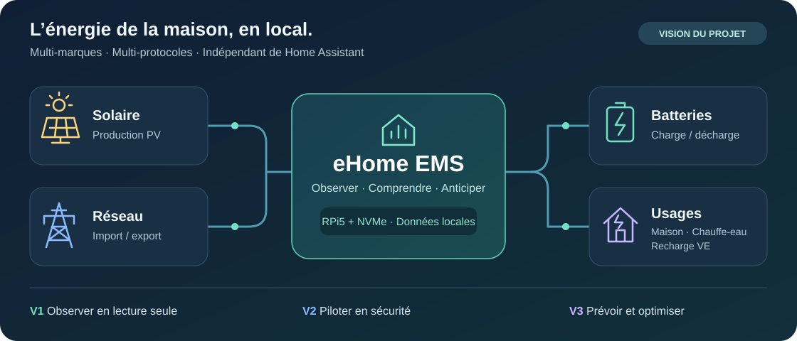

# eHome EMS



**Observer, comprendre et, à terme, piloter l’énergie de la maison — en local.**

eHome EMS est un système résidentiel de gestion de l’énergie **local-first, multi-marques et multi-protocoles**, avec une interface web graphique en français. Son cœur est indépendant de Home Assistant : celui-ci constitue une source de données optionnelle, aux côtés de MQTT et des API des équipements.

> **Statut : cadrage initial.** Le dépôt contient les documents de conception ; le prototype reste à développer. Les fonctions ci-dessous constituent la feuille de route.

## Une architecture ouverte

```text
Sources → Adaptateurs → Normalisation → Moteur de calcul → Stockage local → API → Interface web
```

Les sources prévues sont Home Assistant (WebSocket/REST), MQTT et les API locales ou cloud selon les équipements. Les adaptateurs directs seront ajoutés progressivement. Le traitement et les historiques restent locaux ; une source cloud éventuelle ne définit pas le cœur de l’EMS.

Les mesures seront normalisées : puissance (W), énergie (Wh), charge des batteries (%), horodatage, provenance et qualité. Import/export réseau et charge/décharge seront distingués, avec détection des données périmées ou absentes et prévention des doubles comptages.

## Feuille de route

| Version | Objectif | Fonctions prévues |
| --- | --- | --- |
| **V1 — Observer** | Lecture seule, sans commande aux équipements | Flux en temps réel : production photovoltaïque, consommation maison, import/export, batteries (SOC, puissance, énergie), chauffe-eau, borne VE et consommateurs. Historiques sur 24 h, bilans journaliers, correspondance configurable des entités HA avec les métriques métier, alertes de qualité des données et démonstration simulée. |
| **V2 — Piloter** | Pilotage sécurisé après validation explicite | Priorités, modes de fonctionnement et délestage. |
| **V3 — Anticiper** | Optimisation énergétique | Prévisions solaires, anticipation de consommation et optimisation tarifaire. |

## Équipements ciblés

Périmètre envisagé, dont les intégrations restent à développer et à valider :

- **Production et stockage :** Hoymiles PV, Zendure SolarFlow AC 2400, Aferiy P210.
- **Mesure et équipements associés :** Shelly Pro 3EM, Zlinky, NodOn Zigbee.
- **Usages pilotables à terme :** chauffe-eau, routeur solaire F1ATB et borne VE 20 A.

## Stack et déploiement envisagés

- **Backend :** Python / FastAPI.
- **Frontend :** React / TypeScript, compilé et servi localement.
- **Stockage :** SQLite sur volume persistant.
- **Hébergement :** Raspberry Pi 5 dédié, Raspberry Pi OS Lite 64 bits, SSD NVMe avec HAT PCIe, Docker Engine et Docker Compose ARM64.

Le RPi5 sera distinct du RPi4 hébergeant Home Assistant OS. La première connexion à HA se fera en lecture seule sur le réseau local. Aucune ouverture de port Internet par défaut ; secrets locaux non versionnés, sauvegardes, contrôles de santé et journaux sans secrets sont prévus.

## Prochaines étapes

1. Construire un prototype autonome avec données simulées.
2. Préparer le RPi5/NVMe et les conteneurs Docker Compose ARM64, puis déployer en LAN.
3. Connecter Home Assistant en lecture seule et configurer les métriques.
4. Valider les mesures de référence, les conventions de signe, la fraîcheur des données et l’absence de doubles comptages.

Restent à préciser : fréquence et rétention des données, authentification et éventuel accès distant, RAM, capacité du SSD et connexion Ethernet/Wi-Fi.

## Documentation

- [Cahier des charges](docs/CAHIER_DES_CHARGES.md) — vision et périmètre fonctionnel.
- [Déploiement Raspberry Pi 5](docs/DEPLOIEMENT_RPI5.md) — cible technique et étapes de mise en service.
