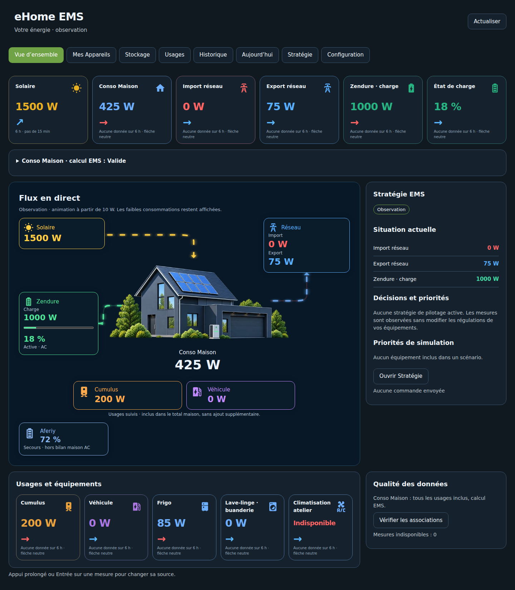
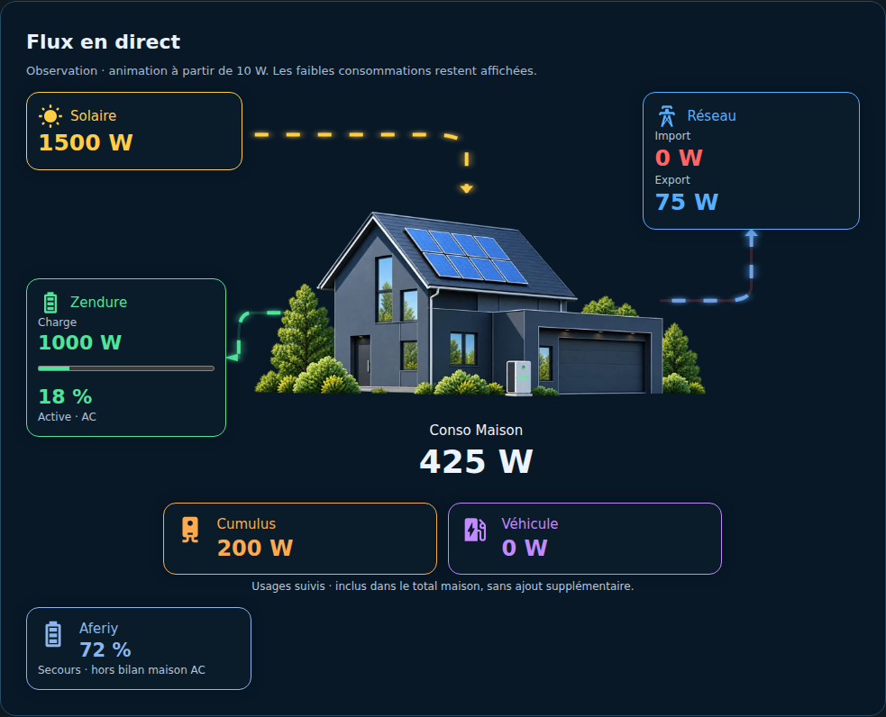
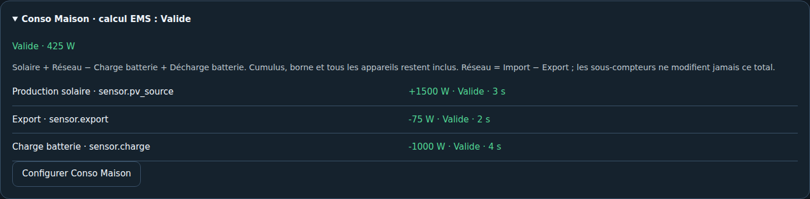
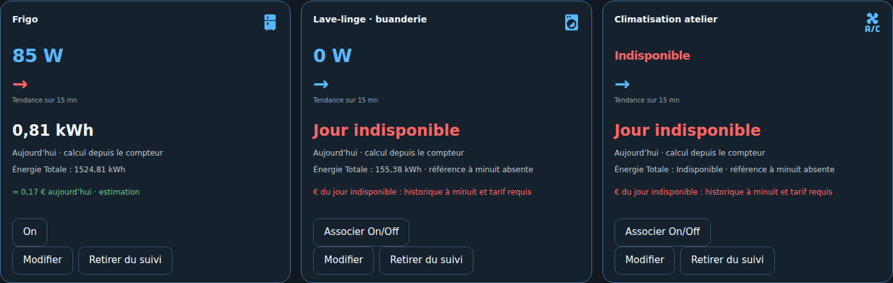
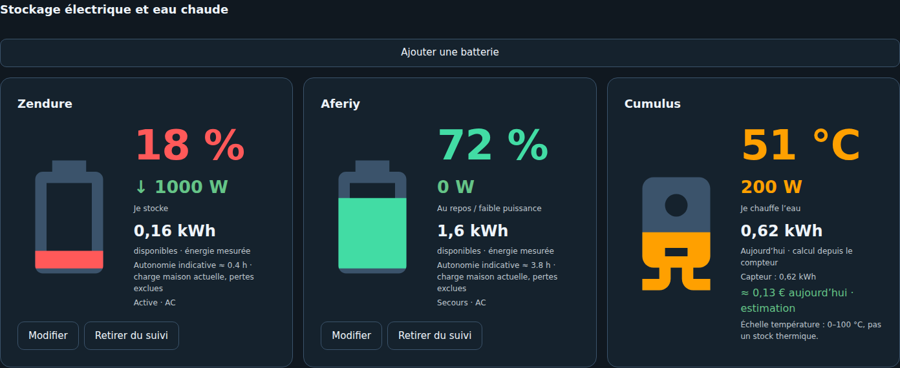
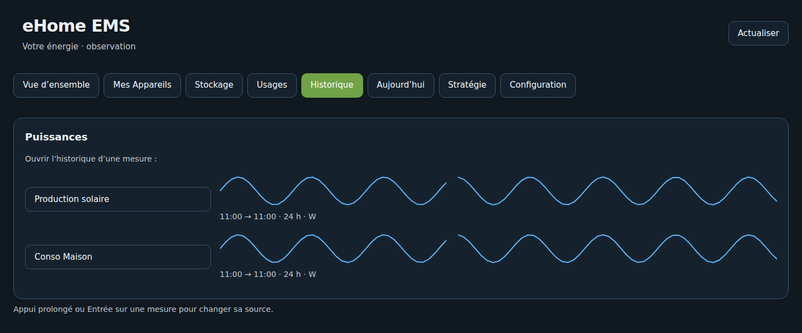
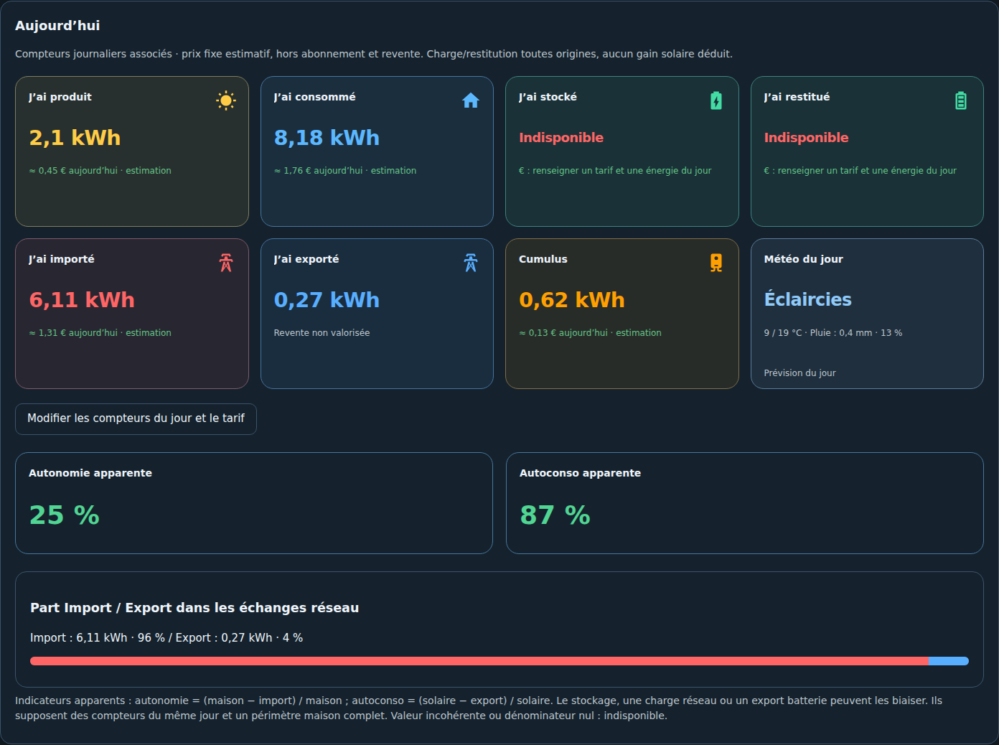
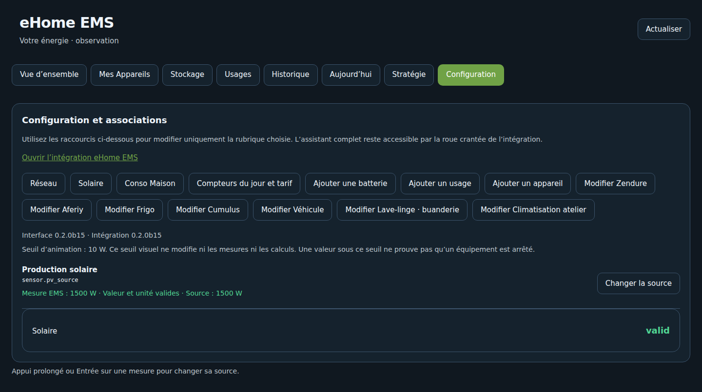
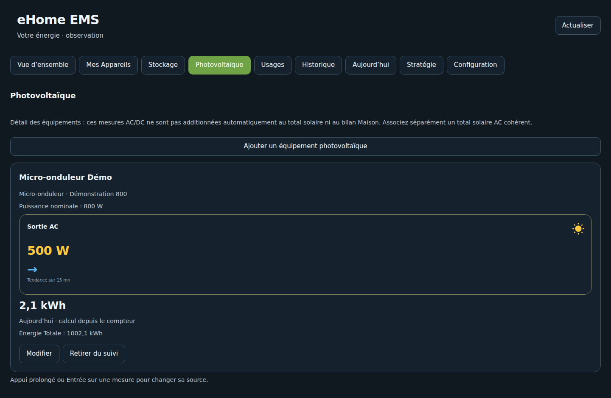
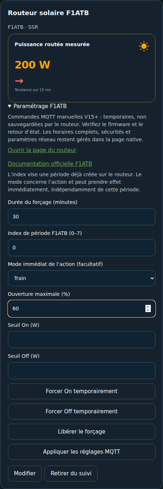

# eHome EMS — Universal Energy Manager

**Votre installation. Vos équipements. Votre énergie. Un EMS sur mesure.**

Une intégration Home Assistant pour comprendre la production solaire, la consommation réelle de la maison, les échanges réseau, le stockage et les appareils. Elle utilise les entités déjà présentes dans HA et fournit son panneau sans YAML à recopier.

**[Version 0.2.18](https://github.com/eHomeLabs/ehome-ems/releases/tag/v0.2.18)** — ECS/F1ATB consolidé, réserve énergétique batterie, jauges et disponibilité des appareils, filtrage metering et météo solaire horaire. [Fonctions, limites et mise à jour](docs/RELEASE_0_2_18.md).

[Installer](docs/INSTALLATION.md) · [Wiki illustré](docs/wiki/Home.md) · [Conso Maison](docs/CONSOMMATION_MAISON.md) · [Changelog](CHANGELOG.md) · [Feuille de route](docs/ROADMAP.md)

## Découvrir le dashboard

Les captures proviennent de la véritable interface avec **des données simulées**, sans connexion à une installation personnelle. Le thème et les équipements dépendent de votre configuration HA.

### Puissances et flux

Une seule flèche par carte : hausse, baisse ou stabilité entre moyennes de quarts d'heure sur les six dernières heures. Sans données suffisantes, flèche horizontale et mention explicite. Rouge lorsqu'une charge consomme une puissance positive, bleue sinon ; solaire, export et décharge restent bleus. Les valeurs sont affichées avec deux décimales maximum, les pourcentages sans décimales.

Import rouge et Export bleu sont distingués. Les flux s'animent à partir de 10 W ; les faibles puissances restent visibles. Les sous-compteurs sont inclus dans le total maison et n'ont pas de flux supplémentaire depuis la maison centrale.

### Comprendre Conso Maison

**Conso Maison = Production solaire + Réseau − Charge batterie + Décharge batterie.**

Réseau positif en import, négatif en export. Avec deux capteurs, Réseau = Import − Export ; EMS ne cumule jamais réseau signé et paire séparée. Cumulus, borne, chauffage et appareils restent inclus dans le total.

Exemple : 2 000 W solaire − 300 W export − 500 W charge batterie = **1 200 W consommés par la maison**. Le calcul exige un périmètre AC cohérent ; une source maison existante adaptée reste disponible comme autre mode.

[Signes, topologies, fraîcheur et données manquantes](docs/CONSOMMATION_MAISON.md)

### Mes Appareils et usages

Ajouter, modifier ou retirer directement un appareil. Les icônes natives HA sont choisies selon le produit, avec sélection manuelle possible. Un compteur total permet de calculer l'énergie du jour depuis la référence de minuit conservée par History/Recorder. Sans référence exploitable, le coût du jour reste indisponible ; une énergie de session reste une énergie de session.

**Énergie Totale** indique le compteur source. Dans l'exemple : 1 524,81 − 1 524 = **0,81 kWh aujourd'hui**, soit environ **0,17 €** au tarif fixe de 0,215 €/kWh. Les coûts sont estimatifs, hors abonnement et revente.

Sur le cumulus, « Température non associée » ou « Température indisponible » concerne l'eau, pas la puissance électrique. [Détails des usages et périodes](docs/USAGES_OBSERVATION.md).

### Stockage

Batteries suivies séparément : actif ou secours, AC/DC, charge/décharge, SOC et stock restant. Le SOC n'est pas présenté comme un stock mesuré. La confirmation d'un capteur réellement représentant le stock, mais mal classé par HA, ne désactive pas le contrôle de cohérence de capacité.

### Historique et Aujourd'hui

Chaque ligne Historique présente les **24 dernières heures**, avec unités, interruptions de données et accès au détail natif HA. History/Recorder doit conserver les sources.

Aujourd'hui rassemble les compteurs quotidiens associés, les coûts estimatifs, les parts Import/Export, les ratios apparents d'autonomie/autoconsommation et la météo HA facultative. Ces ratios ne prouvent pas l'origine solaire de la décharge batterie ; la météo n'est pas une prévision de production photovoltaïque.

### Illustrations maison

Le flux commute automatiquement, dans le fuseau HA : **jour à 07:00**, **nuit à 19:00**. Les images sont incluses dans le paquet.

| Jour | Nuit |
| --- | --- |
|  |  |

[Voir les illustrations et leur fonctionnement](docs/HOUSE_ASSETS.md)

### Configuration et assistant

Les raccourcis ouvrent directement chaque groupe de réglages. Les mesures valides sont vertes, les autres qualités rouges. La confirmation arrive en dernier dans le résumé de l'assistant.

## Installation et mises à jour

Home Assistant **2026.9.1 minimum**. Ajouter `https://github.com/eHomeLabs/ehome-ems` comme dépôt personnalisé HACS / Marketplace, catégorie **Intégration**, puis installer **0.2.11**. L'installation par dépôt personnalisé ne signifie pas validation officielle au catalogue.

**Première installation ou nouveau code Python :** redémarrer Home Assistant Core, puis ajouter l'intégration ou recharger le navigateur après mise à jour. **Réglages courants :** enregistrer suffit, sans redémarrage global. Recharger seulement l'entrée ne remplace pas les modules Python déjà chargés.

Depuis la b15, conserver l'entrée et ses associations. Aucun serveur supplémentaire n'est nécessaire. [Guide complet et retour arrière](docs/INSTALLATION.md).

## Navigation et périmètre livré

| Position | Onglet |
| --- | --- |
| 1 | Vue d'ensemble |
| 2 | Mes Appareils |
| 3 | Stockage |
| 4 | Photovoltaïque |
| 5 | Usages |
| 6 | Historique |
| 7 | Aujourd'hui |
| 8 | Stratégie |
| 9 | Configuration |

| Disponible en 0.2.11 | Suite du projet |
| --- | --- |
| Assistant et réglages ciblés, normalisation et bilan AC | Topologies hybrides/DC avancées |
| Flux, tendances, historique 24 h, stockage et appareils | Analyses historiques et comparaisons |
| Compteurs du jour, cumuls, tarif fixe et météo HA | Tarification avancée et prévisions énergétiques |
| Scénarios sans exécution et commandes On/Off manuelles activées explicitement | Conseils puis pilotage automatique |

Le bouton de création de copie a été retiré. Les dashboards personnels déjà exportés restent préservés et indépendants. Le service `ehome_ems.generate_dashboard` génère une configuration sans écraser un dashboard existant.

[Stratégie ECS v0.2.17 : météo HC, forçages et sécurité compteur](docs/STRATEGIE_ECS_0_2_17.md)

## Documentation et validation

- [Wiki et parcours illustré](docs/wiki/Home.md)
- [Installer et mettre à jour](docs/INSTALLATION.md)
- [Panneau et historique](docs/DASHBOARD_AUTOMATIQUE.md)
- [Conso Maison](docs/CONSOMMATION_MAISON.md)
- [Appareils et usages](docs/USAGES_OBSERVATION.md)
- [Simulation sans commande](docs/SIMULATION.md)
- [Assistant et tests](docs/VALIDATION_ASSISTANT.md)
- [Revue du dépôt 0.2.3](docs/REVUE_0_2_3.md)
- [Cahier des charges](docs/CAHIER_DES_CHARGES.md) et [feuille de route](docs/ROADMAP.md)

La CI contrôle les calculs, les paramètres, le cycle reload/unload, le navigateur desktop/mobile et HA 2026.9.1 / 2026.11.0b0 sous Python 3.14. Elle produit une archive déterministe avec SHA-256. Ces tests ne certifient pas toutes les installations ni le futur pilotage matériel.

## Nouveautés 0.2.3

- Libellé uniforme **Tendance sur 15 mn** ; flèche horizontale si les données sont insuffisantes. Le calcul compare des moyennes de quarts d’heure, avec historique récent disponible.
- Petites puissances négatives d’un appareil corrigées en 0 W dans une tolérance configurable, **5 W par défaut**. La valeur brute et l’indication de correction restent dans les attributs du capteur EMS. La source originale, le réseau signé et le calcul Maison ne sont pas modifiés. Une valeur sous la tolérance reste indisponible.
- Dans **Modifier** un appareil ou usage : choisir une **Entité de commande On/Off** puis cocher **Activer la commande manuelle**. Domaines pris en charge : switch, input_boolean, light et fan. Les boutons affichent l’état réel HA ; un clic administrateur envoie l’action opposée. Aucun capteur de puissance n’est transformé en actionneur.
- Configurer l’**Objectif énergie quotidien (kWh)** depuis Modifier le cumulus dans Usages. **2,16 kWh / 3 kWh = 72 %**. La silhouette est remplie selon cet objectif ; la température reste indiquée séparément. Ce pourcentage représente l’énergie consommée aujourd’hui, **pas la chaleur restante**, ni le SOC d’une batterie. Le remplissage sature à 100 %, mais le pourcentage affiché peut dépasser l’objectif.

[Notes et configuration de la 0.2.3](docs/RELEASE_0_2_3.md)

## Photovoltaïque et routeur solaire F1ATB — 0.2.3

L’onglet **Photovoltaïque**, après Stockage, permet d’ajouter micro-onduleurs, onduleurs DC et hybrides à partir de leurs entités HA. Fabricant, modèle, puissance nominale, sortie AC, production DC, énergie, température, état et flux batterie d’un hybride restent distincts. Ces équipements ne sont **pas additionnés automatiquement** à la production totale ni au bilan Maison : le capteur solaire AC de référence reste celui configuré séparément.

Dans **Usages → Ajouter un usage**, choisir **Routeur solaire**, puis le profil **F1ATB**. Renseigner la page native et/ou le topic exact de l’action. Les mesures sont facultatives pour la fiche de paramétrage ; aucune puissance n’est supposée. Le profil reste distinct d’un **Cumulus / chauffe-eau**, et les associations existantes sont conservées.

Les commandes manuelles MQTT sont désactivées par défaut : confirmer le protocole et activer la souscription sur le routeur, puis activer l’option dans EMS. Forçage On/Off temporisé, libération du forçage, mode de l’action et réglages de seuil/ouverture d’une période existante sont proposés. La publication utilise MQTT HA, sans identifiants à recopier, sans message retenu et sans exécution par les scénarios.

Un ordre publié ne prouve pas sa réception par le F1ATB. Les réglages MQTT sont temporaires et ne remplacent pas sa configuration enregistrée, ses horaires complets ou ses sécurités. [Guide F1ATB et compatibilité](docs/ROUTEUR_F1ATB.md) · [Photovoltaïque](docs/PHOTOVOLTAIQUE.md)

## Nouveauté 0.2.4 : F1ATB HTTP natif

Le profil F1ATB dans Usages propose une connexion **HTTP local direct**, sans installer une autre intégration F1ATB : adresse IP, lecture des actions, suivi des mesures et commandes manuelles activées explicitement. Forçage temporisé, forme d’onde, ouverture forcée et plafond d’une période compatible sont pris en charge, avec relecture du résultat. Le mode MQTT existant reste disponible. Disponible à partir de la version 0.2.4. [Configuration, périmètres et tests](docs/ROUTEUR_F1ATB.md).

## Objectif énergétique avant une échéance

Stratégie propose un objectif par cycle (kWh), une heure d’échéance et un créneau de complément réseau. Le manque et le temps de chauffe sont calculés depuis le compteur cumulé du cumulus, en conservant l’énergie reçue avant minuit. L’observation ne commande rien ; un mode automatique F1ATB HTTP peut être activé explicitement, avec des forçages courts et un retour Auto à l’objectif. Cette évolution est incluse dans la version 0.2.11. [Fonctionnement, limites et tests](docs/OBJECTIFS_ENERGIE.md).
