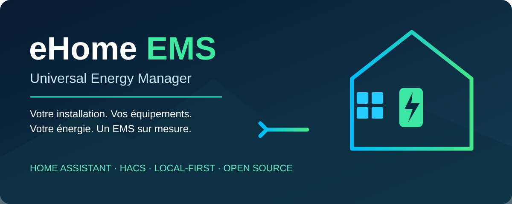

# eHome EMS — Universal Energy Manager

**Votre installation. Vos équipements. Votre énergie. Un EMS sur mesure.**

eHome EMS vise à transformer les données déjà présentes dans Home Assistant en un gestionnaire énergétique guidé : configurer, visualiser, comprendre, prévoir, puis piloter.

**Statut : première bêta 0.2.0b9 en observation, préparée pour les essais.**
Cette branche contient l'assistant, les mesures normalisées, le suivi des batteries
et un dashboard natif exportable. V2 désigne le périmètre produit complet, encore
en développement, et non une release logicielle 2.0.

## Où en est le projet ? — Repères au 31 octobre 2026

| Élément | État actuel |
| --- | --- |
| Code disponible sur cette branche | Bêta 0.2.0b9 en lecture seule, compatible avec les associations V0.1 |
| Cadrage du projet | Cahier des charges V2, qui remplace les anciennes orientations |
| Assistant pas à pas | Réseau, solaire, maison, batteries et vérification ; parcours backend validé sur HA 2026.9.1 et 2026.11.0b0 |
| Stockage | Plusieurs batteries en suivi seul : charge, décharge, SOC et énergie restante mesurée |
| Usages | Routeur solaire/ECS, borne VE et autres charges : puissance, énergie avec période déclarée et état en lecture seule |
| Dashboard | Vue automatique en barre latérale et copie native modifiable sans YAML ; rendu en application HA à valider |
| Prévisions, conseils et pilotage V2 | Prévus dans les lots suivants ; pas encore livrés |
| Prochaine étape | Installer la bêta au moment choisi puis valider les écrans et mesures sur l'installation réelle |
| Ancien serveur autonome RPi5 | Abandonné ; ses guides sont historiques |

**La bêta est une première version de test. Les bilans journaliers,
les prévisions, conseils et commandes ne sont pas encore disponibles.**

### Quel document consulter ?

- **Comprendre ce que nous allons construire :** [cahier des charges V2](docs/CAHIER_DES_CHARGES.md).
- **Installer ou revenir en arrière :** [guide bêta 0.2.0b9](docs/INSTALLATION_BETA.md).
- **Savoir ce qui a été testé :** [rapport de validation backend](docs/VALIDATION_0_2_0B1.md).
- **Suivre l'ordre de développement et la validation :** [feuille de route](docs/ROADMAP.md).
- **Installer ou tester uniquement le prototype existant :** [installation V0.1](docs/INSTALLATION_V0_1.md) et [validation V0.1](docs/VALIDATION_V0_1.md).

Les instructions d'installation V0.1 ne donnent pas accès au dashboard V2. Pour la suite du développement, les références sont le cahier des charges V2 et la feuille de route.

## Premier incrément du lot A — en développement

### Retour des premiers essais — 0.2.0b9

Animation des flux à partir de 10 W, sans effacer les petites consommations.
La hauteur réelle des cartes évite le recouvrement du texte avec une batterie
au repos ; Configuration compare les valeurs source/EMS et explique les qualités
disponibles. Les tests navigateur reproduisent le cas borne à 1 W/batterie à zéro.

Le dashboard est organisé autour d'une navigation haute et d'un flux central :
puissances principales en haut, usages secondaires en bas, situation EMS à droite
sur PC. Stratégie reste en observation ; Configuration expose les associations
et les versions chargées. La b8 évite la réutilisation d'une ancienne classe du
panneau dans une session HA restée ouverte pendant la mise à jour.

Appui prolongé sur les mesures de la vue gérée pour changer leur source
(administrateur, enregistrement explicite, identifiants EMS conservés).
Une icône locale accompagne désormais l’intégration.

Une [vue eHome EMS automatique](docs/DASHBOARD_AUTOMATIQUE.md) est ajoutée à la
barre latérale après configuration. Elle suit les réglages, sans YAML, avec
mesures, jauges, stockage et usages. Un administrateur peut créer une copie
native indépendante modifiable en un clic, sans écraser les dashboards existants.
L'historique du panneau ouvre les fiches natives ; la copie native contient
la carte d'historique. La vue gérée contient désormais un synoptique animé à maison centrale.

Une étape [Usages](docs/USAGES_OBSERVATION.md) suit les batteries : routeur
solaire/ECS, recharge VE et autres charges facultatives. Elle associe puissance
réelle, énergie existante (jour/session/cumul) et état lu uniquement. Le dashboard
exporté présente une vue Usages. Ces mesures ne sont jamais ajoutées au total
maison une seconde fois ; le module ne commande ni F1ATB ni la borne.

L'écran Maison permet de choisir une source existante (mesurée ou déjà calculée)
ou un calcul automatique EMS. Le calcul est limité aux topologies AC confirmées :
import/injection séparés, PV déclaré et mesures charge/décharge de toutes les
batteries actives. Il conserve l'identifiant du capteur Maison. Le résultat reste
indisponible en cas de donnée manquante/périmée ou de bilan négatif.
Voir [la définition de la consommation maison et les conditions du calcul](docs/CONSOMMATION_MAISON.md).

Les écrans expliquent maintenant le choix entre réseau signé et import/injection,
l'utilisation d'une consommation maison déjà calculée et la distinction entre
énergie restante, capacité et compteurs cumulatifs. Une aide par champ accompagne
les batteries. La confirmation explique la vue automatique et la copie indépendante.

Le statut valid signifie valeur et unité lisibles, pas association physique garantie.
Pour l'énergie restante, les sources déclarées total/total_increasing sont refusées.
Un stock supérieur à la capacité déclarée de plus de 10 % est également refusé à
la configuration et rendu indisponible pendant le suivi, avec une raison explicite.
Cette tolérance couvre de petits écarts de capacité nominale/utile et de calibration ;
elle ne prouve pas que les autres associations sont correctes.
HA peut masquer les attributs supplémentaires d'une entité indisponible ; le
motif détaillé reste visible dans l'aperçu de configuration.

Cette branche fournit le premier paquet de test du lot A.
Elle ne constitue pas une livraison complète du lot A ni une validation officielle HACS.

- Conversion W/kW vers W.
- Capteur réseau global signé conservé ; export présenté comme une magnitude
  positive, y compris si le compteur source le publie en négatif.
- Valeur négative sur import, solaire ou maison signalée indisponible.
- Attributs `data_quality`, `source_unit` et `value_origin` sur les capteurs.
- Donnée absente, unité incorrecte ou valeur non finie : aucune substitution par zéro.

L'assistant sépare réseau, solaire, maison, batteries, aperçu et confirmation. Depuis
l'aperçu, chaque étape peut être corrigée. Les réglages V0.1 sont proposés
à nouveau dans les options ; un champ effacé reste effacé. Aucun changement
n'est enregistré avant la validation finale. Les sources absentes, les unités
autres que W/kW, les doublons et les capteurs miroirs eHome EMS sont refusés.
Une source temporairement indisponible avec une unité valide reste configurable,
avec un avertissement dans l'aperçu.

Les batteries peuvent être ajoutées, modifiées et retirées du suivi avant la
confirmation finale. Chaque batterie dispose d'un identifiant stable, d'un rôle
actif ou secours (secours par défaut), d'un couplage AC/DC et d'une capacité utile
facultative en kWh. Les mesures facultatives sont charge/décharge positives en
W/kW, SOC en % et énergie restante mesurée en Wh/kWh. Au moins une mesure est
nécessaire par batterie. Le SOC n'est pas converti artificiellement en énergie.

Le rôle actif inclut la batterie dans le calcul Maison AC lorsqu'il est choisi
et que ses mesures sont complètes. Les batteries de secours en sont exclues et
une batterie active DC bloque ce bilan simple. Aucune commande n'est envoyée. L'origine de
l'énergie stockée reste inconnue : décharger ne signifie pas produire du solaire.

Les bilans énergétiques journaliers et la fraîcheur des autres miroirs
restent à développer. Le synoptique animé de la vue gérée suit les états HA. Un premier [dashboard natif exportable](docs/DASHBOARD_OBSERVATION.md)
est généré par l'action `ehome_ems.generate_dashboard`, sans écrire ni écraser de
dashboard. Cet export reste une alternative à la vue automatique et au bouton de copie ; les copies
personnalisées ne sont pas modifiées par une génération ultérieure. Les identifiants uniques
existants sont conservés. Les automatismes utilisant le signe du miroir
d'export doivent tenir compte de sa nouvelle convention positive.

Installation des dépendances de test : `python -m pip install -r requirements-test.txt`.
Tests de calcul et de parcours :
`python -m unittest discover -s tests -v`.
La CI vérifie aussi la syntaxe Python. Les tests du parcours utilisent les
vrais schémas Voluptuous et des doubles des API HA ; ils ne remplacent pas
un test de chargement/rechargement dans Home Assistant.
Voir le [plan de validation de l'assistant](docs/VALIDATION_ASSISTANT.md).

Une validation supplémentaire utilise un vrai Home Assistant Core dans un
environnement temporaire avec sources simulées. Installer les dépendances
de requirements-ha-test.txt dans un environnement Python 3.14 séparé, puis
exécuter `python scripts/validate_home_assistant.py`.
La cible actuelle est 2026.11.0b0 ; la CI vérifie aussi 2026.9.1.
Elle vérifie les API réelles de configuration, les capteurs, les changements
d'état, le renommage, l'action dashboard, les options, le rechargement,
le déchargement et la compatibilité des anciennes données V0.1.
La sérialisation du formulaire batterie pour l'interface HA est aussi vérifiée.
Cela ne remplace pas les essais matériels et visuels sur l'installation réelle.

## Documentation de référence

- **[Cahier des charges complet V2](docs/CAHIER_DES_CHARGES.md)**
- [Feuille de route et critères de validation](docs/ROADMAP.md)
- [Accueil de la documentation](docs/wiki/Home.md)

## Une intégration Home Assistant

Distribution cible via HACS / Marketplace, configuration pas à pas et dashboard adapté aux équipements réellement présents. Les données et commandes utilisent les intégrations HA existantes, quels que soient leurs protocoles ou fabricants.

Le socle fonctionne localement, sans serveur autonome ni abonnement eHome EMS. Les sources tierces peuvent dépendre du cloud. Une IA éventuelle reste facultative.

## Installation guidée cible

1. Choisir les modules présents.
2. Associer les mesures réseau, photovoltaïque et maison.
3. Ajouter les batteries et leurs rôles.
4. Déclarer les usages et les commandes disponibles.
5. Configurer tarifs, objectifs, contraintes et réserves.
6. Ajouter les prévisions disponibles, facultativement.
7. Vérifier unités, signes, fraîcheur et bilan.
8. Prévisualiser puis générer le dashboard en observation.

Suggestions d'entités modifiables, reprise du parcours et réglages rechargeables sans redémarrage complet de HA. La première installation et certaines mises à jour peuvent nécessiter un redémarrage.

## Modules

| Module | Fonctions cibles |
| --- | --- |
| Photovoltaïque | Plusieurs sources, production, énergie, prévisions |
| Réseau | Import/export, tarifs, coûts et limites |
| Maison | Consommation, talon, historique et bilan |
| Stockage | Plusieurs batteries, SOC, réserve, charge/décharge et rôle secours |
| Surplus | Export mesuré, allocations en cours et puissance réallouable |
| Usages | ECS/routeur, VE, piscine, chauffage/PAC et autres charges |
| Analyse | Autoconsommation, autonomie, anomalies, coûts et comparaison réel/prévu |

L'absence d'un module ne bloque pas les autres.

## Dashboard cible

- Flux animé solaire/maison/réseau/batteries/usages, inspiré de la lisibilité Zendure.
- Jauges de puissance W/kW et d'énergie kWh avec période explicite.
- Vues Synthèse, Aujourd'hui, Historique, Stockage, Usages, Prévisions, Conseils et Réglages.
- Adaptation mobile, tablette et PC ; valeurs et sens compréhensibles sans couleur.
- Personnalisation conservée et copie librement éditable sans écrasement par une régénération.

La génération et le conditionnement des ressources frontend seront validés par prototype.

## Mesures et décisions explicables

Les mesures, calculs et estimations sont distingués. Les unités, signes, topologies AC/DC et doubles comptes sont contrôlés. Une source indisponible n'est jamais remplacée arbitrairement par zéro.

L'injection réseau seule ne représente pas tout le surplus réallouable. La décharge d'une batterie ne doit pas être assimilée automatiquement à du solaire, notamment après charge en heures creuses.

Les conseils indiquent hypothèses, contraintes et gains estimés. Les prévisions présentent leur fraîcheur et leurs erreurs ; les économies simulées restent distinctes des résultats mesurés.

## Modes de fonctionnement cibles

| Mode | Comportement |
| --- | --- |
| Observation | Mesurer, afficher et analyser, sans commande |
| Conseil | Proposer une action et sa justification |
| Simulation | Journaliser les décisions sans les exécuter |
| Automatique | Commander uniquement les équipements explicitement activés |

Un arbitre coordonne stockage et usages selon leurs priorités, réserves, échéances et limites. Il doit coopérer avec les régulations existantes, dont F1ATB, et respecter les reprises manuelles et les données périmées.

## Développement progressif

| Lot | Livrable |
| --- | --- |
| A — Socle visuel | Assistant, mesures fiables, flux, jauges et statistiques en lecture seule |
| B — Compréhension | Tarifs, analyses, prévisions et conseils |
| C — Orchestration | Simulation puis pilotage coordonné |
| D — Optimisation | Profils, scénarios et planification avancée facultative |

**Première priorité : lot A sur le banc de validation RPi4 avec SSD.** Aucun solveur lourd obligatoire. Les interfaces des lots B et C doivent être anticipées.

## Inspirations

PV Pilot pour la simplicité et le surplus ; Home Assistant Energy pour les statistiques ; Predbat pour la batterie prévisionnelle ; EMHASS pour la planification ; evcc pour la recharge solaire. Les liens et limites de l'étude figurent dans le [cahier des charges](docs/CAHIER_DES_CHARGES.md). Aucun de ces projets n'est une dépendance obligatoire.

## Prototype et historique

Le [guide V0.1](docs/INSTALLATION_V0_1.md) et le [plan de validation V0.1](docs/VALIDATION_V0_1.md) concernent uniquement le prototype existant. Ils ne permettent pas d'installer les fonctions V2.

Les pages numérotées de l'ancien guide RPi5 sont historiques et obsolètes. Le serveur autonome est abandonné ; consulter la [note correspondante](docs/DEPLOIEMENT_RPI5.md).

Cette branche contient du code en développement. Aucune installation Home Assistant
réelle n'a été modifiée pendant son développement.
