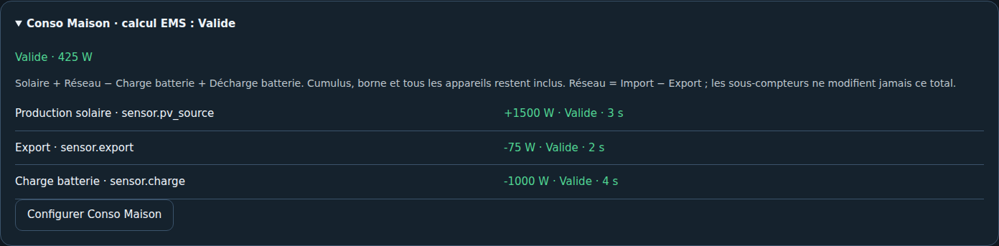

# Conso Maison : comprendre le bilan

Conso Maison représente la puissance réellement consommée par tous les usages : électroménager, éclairage, chauffage, cumulus, piscine et borne de recharge. Elle s'exprime en W/kW. La charge électrique des batteries est un flux séparé.

## Source existante ou calcul automatique

Une source existante peut être une mesure complète ou un template déjà calculé. EMS la reprend sans soustraire les sous-compteurs. Une pince mesurant seulement l'arrivée réseau ne représente pas à elle seule le total consommé lorsque solaire et batteries alimentent la maison.

Le mode automatique applique :

**Conso Maison = Production solaire + Réseau − Charge batterie + Décharge batterie**

Le réseau signé est positif à l'import, négatif à l'export. Avec deux sources séparées : **Réseau = Import − Export**, chacune en magnitude positive. Le mode réseau « Auto » choisit la paire complète Import/Export si elle est configurée, sinon le réseau signé ; il ne cumule jamais les deux représentations. Un choix explicite « signé » ou « séparé » est disponible.

**Exemple :** solaire 2 000 W, export 300 W, charge batterie 500 W et décharge 0 W donnent **1 200 W** de consommation maison, sans achat réseau. Le cumulus reste inclus, de même que la borne : leurs cartes expliquent le total et ne sont ni ajoutées une seconde fois ni soustraites.

## Périmètre AC

- Confirmer le même périmètre électrique pour toutes les mesures ; une puissance pack/DC n'est pas interchangeable avec une puissance côté AC.
- Déclarer le solaire réellement présent et son total AC, sans sommer un total avec ses sous-ensembles.
- Déclarer toutes les batteries actives, avec charge et décharge positives distinctes. Les batteries de secours restent hors de ce bilan quotidien.
- Une batterie active DC n'est pas compatible avec ce bilan AC simple. Utiliser une source maison existante adaptée à la topologie.
- Une absence déclarée de solaire ou stockage n'est pas une façon de contourner une source manquante d'un équipement réellement présent.

## Qualité et fraîcheur

Une source requise absente, indisponible, non numérique, de mauvaise unité ou de signe inattendu bloque le résultat. Un bilan négatif reste indisponible (`negative_balance`), sans être rabattu à zéro.

L'âge maximal est réglable : 300 s par défaut, de 30 à 3 600 s, ou 0 pour désactiver explicitement le contrôle d'âge. En observation, la politique « Signaler sans bloquer » laisse visible un bilan calculable malgré une source ancienne ; le mode strict le bloque. Une valeur stable à 0 W peut être valide même si le capteur ne publie que les changements. Aucune politique ne transforme une donnée absente ou invalide en valeur utilisable.

Le diagnostic détaille les contributions, la représentation réseau, les âges et la qualité. Des publications non synchronisées peuvent expliquer des écarts transitoires. L'attribut `value_origin` distingue source externe et calcul EMS. Changer de mode conserve l'identifiant logique du capteur maison.

Ce bilan est une puissance instantanée : il ne calcule pas à lui seul l'énergie journalière, l'origine solaire du stock batterie ni une économie réalisée.
