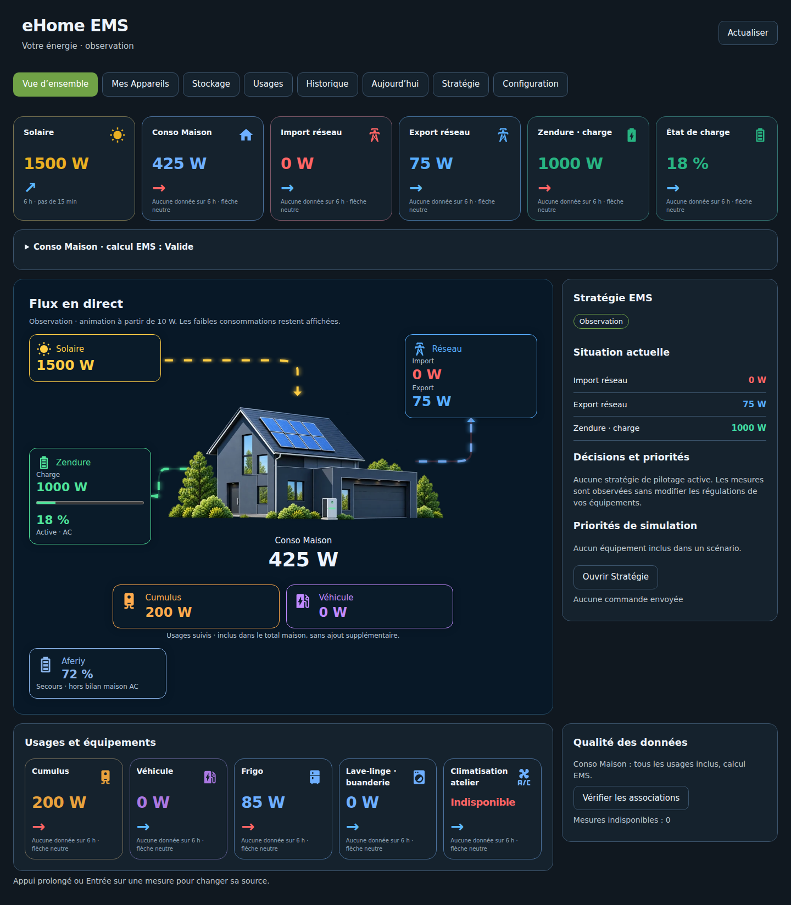
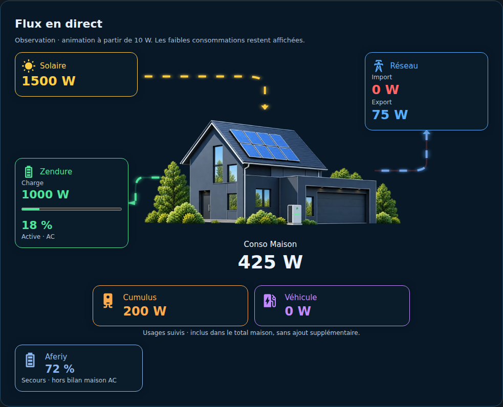
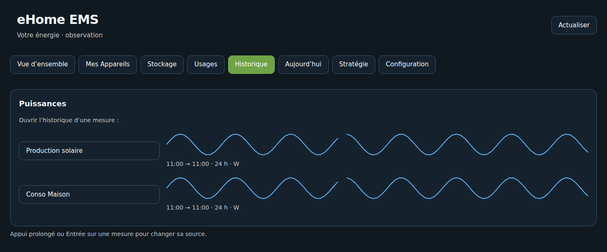
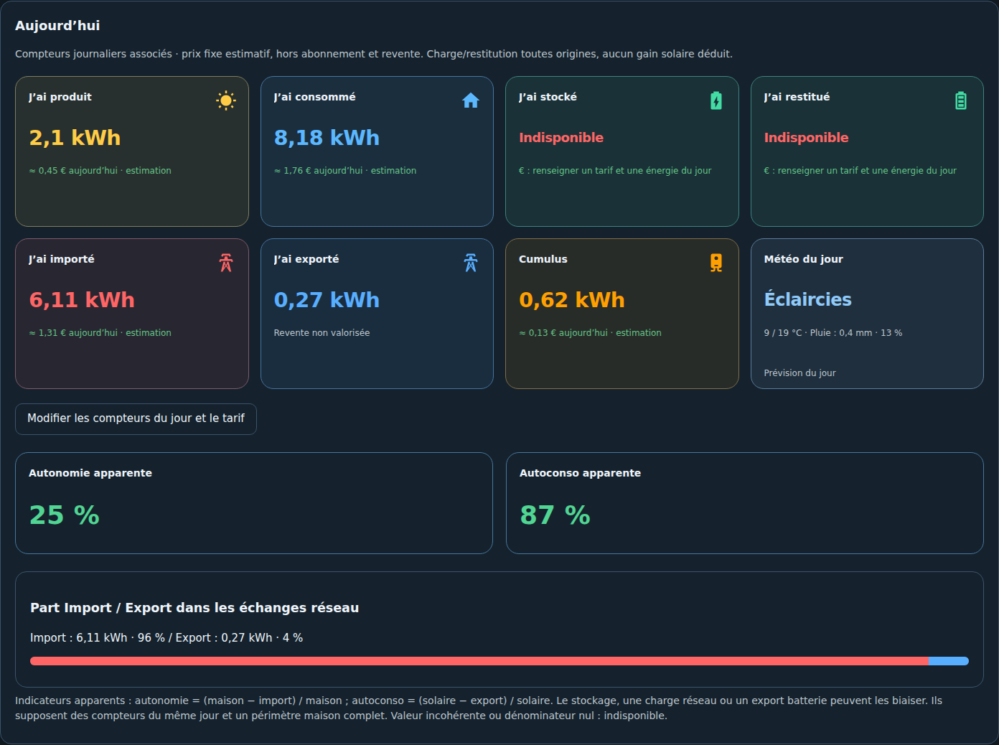

# Le panneau eHome EMS 0.2.1

Le panneau géré apparaît dans la barre latérale HA après confirmation de l'assistant. Il suit les associations et respecte les droits administrateur pour les modifications. Aucun YAML à copier, ni intégration graphique externe à installer.

| Position | Onglet | Contenu |
| --- | --- | --- |
| 1 | Vue d'ensemble | Puissances, tendances, flux et diagnostic Conso Maison |
| 2 | Mes Appareils | Ajout et modification directs, énergie quotidienne et cumul source |
| 3 | Stockage | Batteries distinctes, rôle actif/secours, charge/décharge, SOC et stock |
| 4 | Usages | Routeur/cumulus, borne et sous-consommations |
| 5 | Historique | Courbes 24 h par source et ouverture du détail HA |
| 6 | Aujourd'hui | Compteurs journaliers, coûts estimatifs, ratios apparents et météo |
| 7 | Stratégie | Situation observée et scénarios manuels sans commande |
| 8 | Configuration | Raccourcis d'édition, versions et qualité des associations |

## Flux et tendances

Les flux distinguent Import rouge et Export bleu. Les faibles consommations restent affichées ; l'animation débute à 10 W. Cumulus et borne sont des sous-comptages inclus : aucun flux supplémentaire ne relie Conso Maison à ces cartes.

La maison utilise le visuel jour de 07:00 à 18:59 et nuit de 19:00 à 06:59, dans le fuseau HA. Les cartes gardent une seule flèche de tendance ; les détails des règles figurent dans [Usages](USAGES_OBSERVATION.md).

## Historique et Aujourd'hui

L'historique charge les sources réelles sur une fenêtre de 24 heures, par requête groupée bornée et cache court. Les interruptions ne sont pas comblées artificiellement. Les unités de la source sont indiquées ; cliquer sur son nom ouvre le détail natif HA. Une absence de données reste explicite.

Aujourd'hui utilise les compteurs quotidiens associés et un tarif fixe facultatif. Les ratios sont qualifiés d'**apparents** : l'origine solaire du stock batterie n'est pas démontrée. La météo provient d'une entité `weather` HA et de sa prévision quotidienne disponible ; elle ne constitue pas une prévision de production solaire.

## Réglages et personnalisation

Les raccourcis de Configuration ouvrent directement la section concernée. Une modification d'association recharge l'intégration sans redémarrage complet. L'appui prolongé ou Entrée sur une mesure permet de changer sa source quand le panneau le propose.

Le bouton « Créer une copie modifiable » a été retiré. Les dashboards personnels déjà exportés restent indépendants et sont préservés. Le service `ehome_ems.generate_dashboard` reste disponible : il génère une configuration, sans écraser un dashboard existant. Le panneau géré n'est pas l'éditeur Lovelace d'une copie personnelle.
