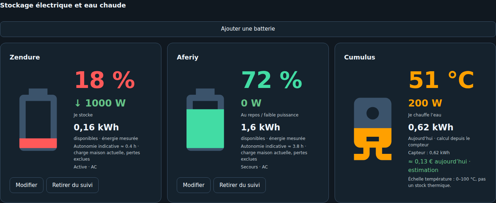

# Observation et qualité des données

La version 0.2.1 lit les sources HA, normalise les mesures et présente les flux. Les modifications du panneau enregistrent des paramètres EMS ; elles ne commandent pas les appareils.

Une valeur **valid** signifie que la valeur et son unité sont exploitables pour le rôle demandé. Elle ne prouve pas que la pince est au bon endroit ni que plusieurs capteurs ont le même périmètre. Le résumé de vérification affiche valid en vert et les autres qualités en rouge, avec leur libellé explicite.

Les états absents ou invalides ne deviennent jamais 0 W. Les diagnostics distinguent unités, direction, stock/cumul, âge des sources et incohérences de bilan. Les données de secours ou DC peuvent être suivies sans être admissibles au bilan actif AC.

Le contrôle d'âge de Conso Maison peut avertir ou bloquer selon la politique choisie ; voir [Conso Maison](CONSOMMATION_MAISON.md).

Les puissances sont des flux, les kWh des énergies et le SOC un pourcentage. Deux décimales maximum à l'affichage des nombres ; pourcentages sans décimales. Le formatage d’affichage est distinct de la normalisation des mesures.

[Présentation du panneau](DASHBOARD_AUTOMATIQUE.md) · [Validation](VALIDATION_ASSISTANT.md)
