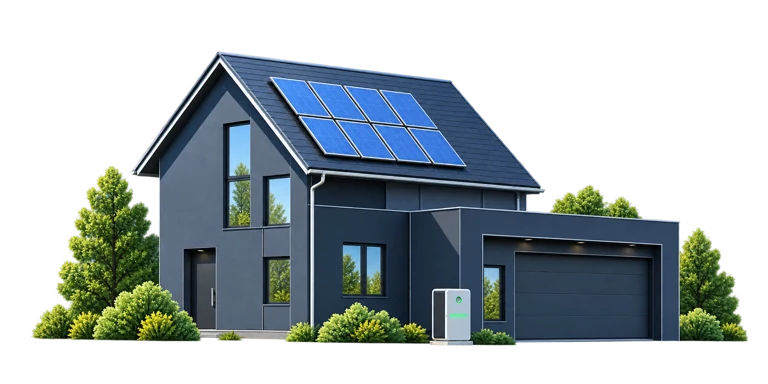
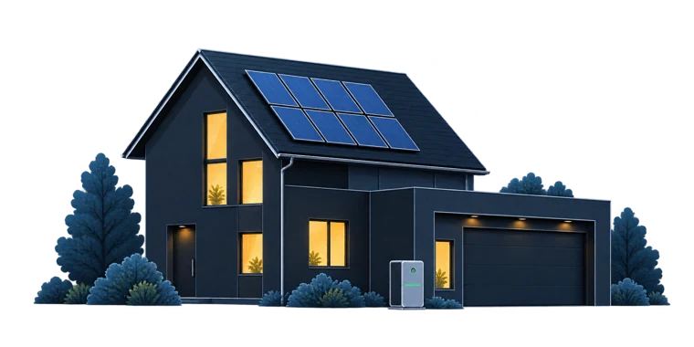
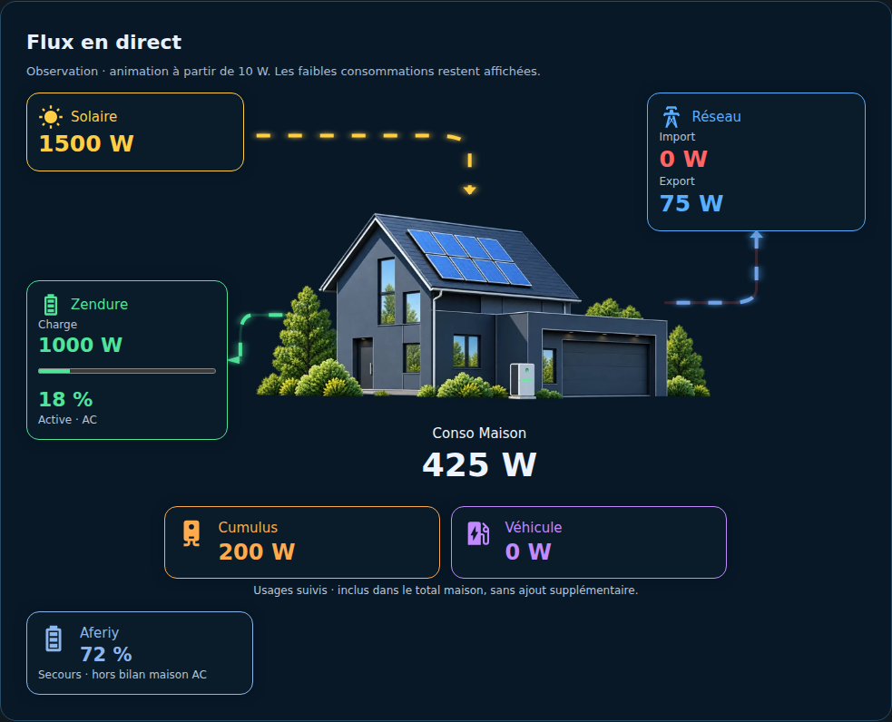

# Illustrations maison — jour et nuit

Ces deux illustrations sont celles utilisées par le flux eHome EMS. Elles sont incluses dans l'intégration : aucun téléchargement externe n'est requis au fonctionnement.

## Mode jour

**07:00 à 18:59**, dans le fuseau de Home Assistant. Fichier : `custom_components/ehome_ems/frontend/assets/house-day.webp`.

## Mode nuit

**19:00 à 06:59**, dans le fuseau de Home Assistant. Fichier : `custom_components/ehome_ems/frontend/assets/house.webp`.

La commutation utilise les heures fixes demandées, pas le lever/coucher du soleil ni la météo. Les limites horaires, le changement d'heure et la stabilité de la géométrie sont testés.

Les visuels ont été produits avec Image Gen, la version jour dérivée de la maison de nuit en conservant architecture, cadrage, panneaux, garage et batterie. Ils restent des illustrations : aucune valeur énergétique n'y est représentée. Les assets WebP transparents limitent la taille du paquet.

[Le panneau](DASHBOARD_AUTOMATIQUE.md) · [Wiki illustré](wiki/Home.md)
