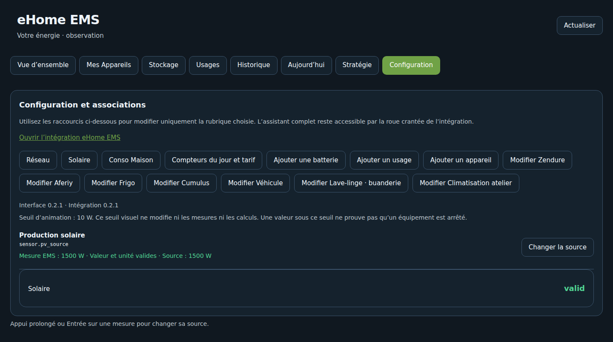

# Installer et mettre à jour eHome EMS 0.2.1

L'intégration utilise votre Home Assistant et les entités de vos équipements déjà intégrés. Aucun serveur supplémentaire n'est nécessaire. Le dépôt est public ; son ajout comme dépôt personnalisé HACS / Marketplace ne constitue pas une validation officielle au catalogue.

## Prérequis

- Home Assistant 2026.9.1 minimum. La CI contrôle 2026.9.1 et 2026.11.0b0 ; elle ne valide pas toutes les versions intermédiaires ni chaque matériel.
- Des mesures réelles en W/kW et, si disponibles, des compteurs en Wh/kWh.
- History/Recorder doit conserver les sources pour l'historique et le calcul journalier depuis un cumul. Ne pas désactiver globalement Recorder.
- Une sauvegarde HA disponible avant installation ou mise à jour.

## HACS / Marketplace

1. Ajouter `https://github.com/eHomeLabs/ehome-ems` aux dépôts personnalisés, catégorie **Intégration**.
2. Installer la version **0.2.1** depuis la [release](https://github.com/eHomeLabs/ehome-ems/releases/tag/v0.2.1).
3. À la première installation ou après remplacement du code Python, redémarrer **Home Assistant Core** une fois. Aucun redémarrage du système hôte n'est demandé.
4. Ouvrir **Paramètres → Appareils et services → Ajouter une intégration → eHome EMS**.
5. Parcourir l'assistant : réseau, solaire, Conso Maison, batteries, usages, appareils et compteurs du jour. Vérifier les mesures puis confirmer en dernière position.
6. Ouvrir eHome EMS dans la barre latérale. Aucun YAML à copier pour le panneau géré.

## Installation manuelle

Télécharger `ehome-ems-0.2.1.zip` et son fichier `.sha256` depuis la release. Extraire le dossier `custom_components/ehome_ems` dans `/config/custom_components/ehome_ems`, vérifier `manifest.json` puis redémarrer HA Core. Ne pas créer un second niveau de dossier `ehome_ems/ehome_ems`.

## Migrer depuis la b15

Mettre à jour les fichiers sans supprimer l'entrée existante : les associations et identifiants restent conservés. Redémarrer HA Core pour charger le code, puis recharger le navigateur. Dans **Configuration**, vérifier que les versions Interface et Intégration indiquent toutes deux **0.2.1**.

## Quand faut-il redémarrer ?

| Action | Opération nécessaire |
| --- | --- |
| Ajouter ou modifier un appareil, une source, un tarif ou une icône | Enregistrer ; rechargement automatique de l'intégration |
| Changer les priorités de simulation | Enregistrer dans le panneau ; aucune commande réelle |
| Recharger un panneau resté en cache | Actualiser le navigateur, rechargement forcé si nécessaire |
| Première installation ou nouvelle version du code Python | Redémarrer Home Assistant Core |
| Mettre à jour uniquement une image ou du JavaScript | Recharger le navigateur peut suffire ; suivre les notes de release |

Recharger une entrée HA ne remplace pas les modules Python déjà chargés. Les réglages courants ne nécessitent pas de redémarrage global.

## Retour arrière

Conserver la sauvegarde et la release précédente. Si nécessaire, réinstaller les fichiers de la b15 puis redémarrer HA Core et recharger le navigateur. Si un format de configuration a changé dans une future version, utiliser une sauvegarde compatible ; la 0.2.1 ne change pas le schéma d'associations de la b15. Ne pas supprimer l'intégration pour un simple rafraîchissement du panneau.

[Assistant](VALIDATION_ASSISTANT.md) · [Dépannage](wiki/09-Depannage.md) · [README](../README.md)
