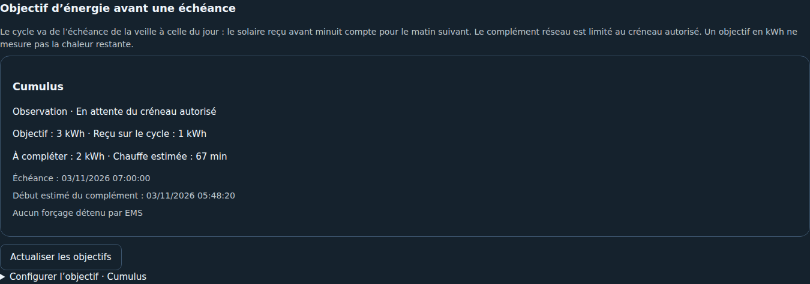

# Objectif d’énergie avant une échéance — évolution en développement

Cette fonction est développée après la version publiée 0.2.5. Elle ajoute des objectifs de chauffe à Stratégie ; la répartition hypothétique en W reste une simulation indépendante, sans commande.

## Exemple : 3 kWh pour le matin

Un objectif de 3 kWh et une échéance à 7 h définissent un cycle de **7 h la veille à 7 h le matin**. L’énergie reçue avant minuit est conservée dans ce cycle. Si le compteur dédié au cumulus montre 1 kWh reçu sur ce cycle, il reste 2 kWh à fournir. À 1 800 W, cela représente environ 67 minutes de chauffe effective.

Pendant la journée, le routeur continue sa régulation solaire native. Le complément est déclenché le plus tard possible dans le créneau réseau autorisé, avec une marge de démarrage configurable. Les consommations réseau déjà reçues comptent aussi : toute énergie mesurée par le compteur du cumulus contribue au même objectif, quelle que soit son origine. EMS n’invente pas une origine solaire.

## Paramètres dans Stratégie

- Usage concerné : cumulus/chauffe-eau ou routeur solaire.
- Mode **Observation** par défaut, ou **Complément automatique autorisé** par activation explicite.
- Objectif par cycle en kWh, échéance quotidienne et créneau autorisé pour le complément (y compris à cheval sur minuit).
- Puissance de chauffe à pleine ouverture en W et marge en minutes.
- Compteur cumulé du **seul cumulus**, en Wh ou kWh, avec confirmation qu’il ne se remet pas à zéro à minuit. Un compteur journalier ou de session ne convient pas.
- Ancienneté maximale du compteur (300 secondes par défaut).
- Routeur F1ATB HTTP associé pour le mode automatique, avec ses commandes manuelles activées et son ouverture en marche forcée configurée à 100 %.

L’objectif du cycle est indépendant de l’indicateur de consommation du jour civil affiché dans Usages. Une seule échéance est définie par cycle dans cette première version : 3 kWh ne sont pas demandés deux fois pour deux échéances. Début et fin du créneau identiques signifient une autorisation sur 24 h.

L’état indique la cible, l’énergie reçue, le manque, la durée estimée, l’échéance, le début de complément estimé et la raison de l’attente, de la chauffe ou du blocage. Si le créneau restant ne suffit pas, EMS le signale et utilise au mieux le créneau autorisé ; il ne promet pas que l’objectif sera atteint.

## Mesures, minuit et redémarrages

History/Recorder fournit le compteur au début du cycle et permet de vérifier les baisses du compteur. La différence entre le cumul actuel et cette référence représente l’énergie consommée dans le cycle. La référence correspond à la valeur enregistrée à cette limite, avec la résolution et la précision du compteur. Un compteur stable continue à représenter une valeur valide ; le réglage d’ancienneté doit rester cohérent avec ses rapports réels.

Sans référence à la limite du cycle, le résultat reste indisponible ; une installation en milieu de cycle ne commence pas arbitrairement à zéro. Le compteur doit être inclus dans Recorder. Une remise à zéro détectée bloque le cycle plutôt que de demander une chauffe supplémentaire sur une estimation. À chaque rechargement, l’historique est relu ; la progression ne repart pas de zéro. Les bornes utilisent le fuseau HA, avec des cycles de 23 ou 25 heures lors du changement d’heure. Pour une heure inexistante au printemps, l’échéance est décalée après le saut ; pour une heure répétée en automne, la première occurrence est retenue.

Une température actuelle peut aider à comprendre le confort obtenu. Dans cette première version, la température et le maximum du jour ne commandent pas le complément. Un objectif électrique atteint ne prouve pas qu’il reste suffisamment d’eau chaude après des soutirages.

## Pilotage automatique borné — F1ATB HTTP uniquement

L’observation ne commande rien. Le mode automatique nécessite un choix explicite et un bouton d’activation distinct. La lecture du tableau de bord, l’actualisation et les scénarios ne déclenchent aucune commande ; un contrôleur périodique séparé évalue les objectifs activés toutes les 30 secondes.

EMS force la marche pendant **une ou deux minutes**, puis renouvelle au besoin. La durée est réduite à l’approche de la fin du créneau ; aucun nouveau forçage n’est envoyé dans les dernières secondes lorsqu’il ne peut plus expirer avant la limite. Si HA s’arrête brutalement, le bail déjà envoyé expire seul sur le routeur. La cadence et la résolution du compteur impliquent qu’un objectif n’est pas une limite électrique au Wh près.

Lorsque l’énergie cible est atteinte, EMS libère son forçage et revient en **Auto**. Il n’envoie pas un arrêt forcé : la régulation solaire native peut encore ajouter de l’énergie. Le mode, l’ouverture, les horaires et les paramètres enregistrés du routeur ne sont jamais réécrits par ce contrôleur.

Un forçage F1ATB peut prendre priorité sur ses horaires et conditions de routage. Le thermostat matériel et les protections du cumulus restent indispensables ; ce contrôleur ne remplace pas une régulation thermique. Si l’ouverture forcée est inférieure à 100 %, EMS refuse le complément sans modifier ce réglage.

Une commande manuelle EMS suspend l’objectif pour le reste du cycle. Les forçages externes détectés ont aussi priorité ; EMS ne libère pas un forçage long qui ne correspond pas à son bail. Le firmware n’expose pas de jeton de propriétaire : un forçage externe identique d’une ou deux minutes ne peut pas toujours être distingué d’un bail EMS. Prévoir un seul contrôleur automatique pour l’action. Les objectifs EMS concurrents sur la même action sont exclus par un verrou partagé.

Un ordre non confirmé n’est pas réessayé automatiquement. L’intention est conservée avant envoi pour qu’un redémarrage ne provoque pas une répétition ambiguë ; après vérification, le bouton **Réarmer** permet une nouvelle évaluation. Après un crash avec un forçage déjà actif, un réarmement peut être nécessaire. Les données absentes, trop anciennes ou un compteur remis à zéro suspendent le complément.

Désactiver ou retirer un objectif, modifier ses réglages ou recharger l’intégration tente de libérer uniquement le bail qu’EMS détient encore. En cas de communication impossible, sa courte durée borne le forçage restant. Les commandes MQTT et les actionneurs On/Off génériques restent manuels dans cette première version ; ils ne disposent pas du même retour d’état et de la même expiration native.

## Validation

Tests simulés : manque de 2 kWh, déclenchement tardif, minuit, changement d’heure, fenêtres insuffisantes, historique manquant, remise à zéro, fraîcheur, priorité manuelle, bail court et libération à la cible. Les tests HA vérifient les droits WebSocket, la persistance de configuration et le rechargement, avec un historique de cycle et un routeur simulés. Un test supplémentaire vérifie la référence de début de cycle, la progression, la remise à zéro et la référence absente via la véritable API Recorder sur une base SQLite temporaire. Ces tests ne constituent pas une validation sur un cumulus réel.
