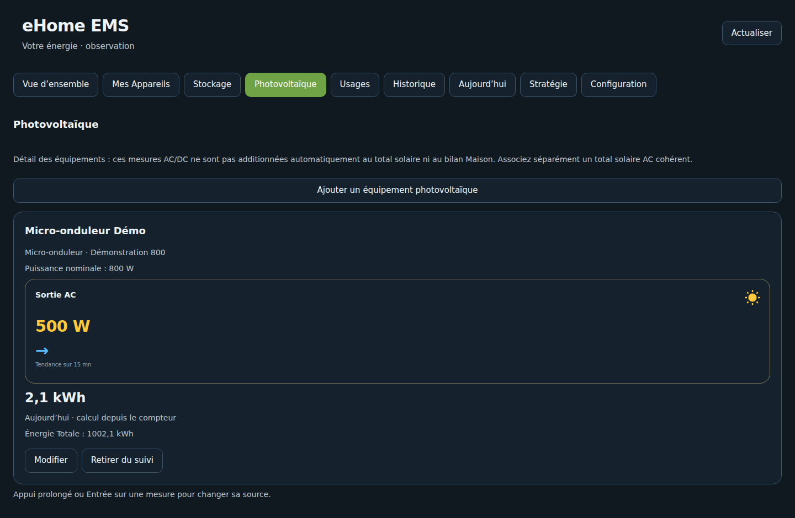

# Équipements photovoltaïques — 0.2.3

L’onglet Photovoltaïque se situe après Stockage. Ajouter, modifier, renommer et retirer un équipement depuis cet onglet ; les raccourcis existent aussi dans Configuration. Retirer du suivi ne désinstalle pas son intégration HA.

## Types et mesures

- Micro-onduleur : fabricant, modèle, puissance nominale et sortie AC.
- Onduleur DC : source de production DC explicitement identifiée ; la sortie AC éventuelle est séparée.
- Onduleur hybride : sortie AC, entrée photovoltaïque DC et charge/décharge batterie distinctes.
- Énergie en Wh/kWh avec période déclarée : jour, cumul ou session ; température et état facultatifs.

Au moins une mesure est requise. Les sources existantes HA sont lues directement ; elles ne sont pas reconfigurées. Les mauvaises unités et les sources EMS récursives sont refusées. Les identifiants de fiches sont stables lors des modifications.

## Éviter les doubles comptes

Cette collection est descriptive : aucun équipement n’est ajouté automatiquement au total de production ni au calcul Maison. Un hybride peut mélanger solaire et batterie sur son port AC ; ne pas présenter toute sa sortie comme une production solaire. Le bilan AC continue d’utiliser le total et les batteries actives explicitement associés dans Configuration.

Les tendances utilisent les sources, et les courbes de puissance sont accessibles dans Historique. Un cumul peut fournir une énergie quotidienne avec une référence de minuit exploitable ; une session ne devient pas une énergie du jour. Les données absentes restent indisponibles.

[Wiki](wiki/Home.md) · [Conso Maison](CONSOMMATION_MAISON.md)
