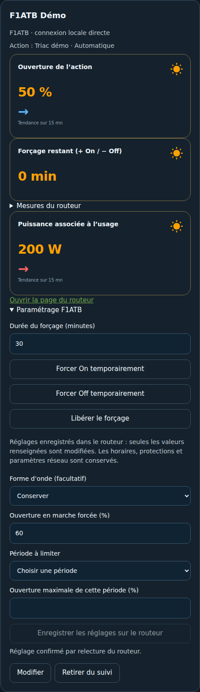
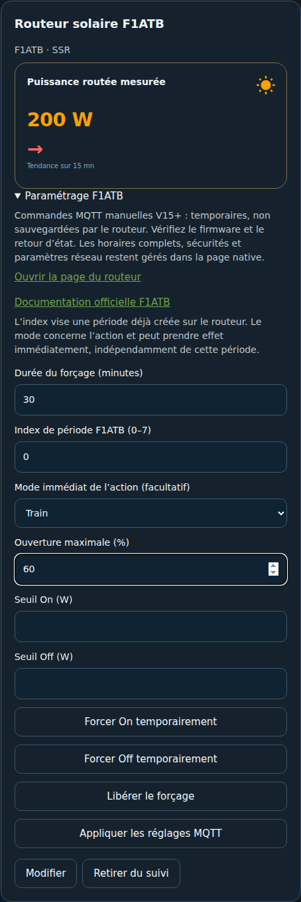

# Routeur solaire F1ATB — HTTP natif et MQTT

Le mode **HTTP local direct** est disponible depuis la version **0.2.4**, sans installer une autre intégration F1ATB. Le mode MQTT de la version 0.2.3 reste compatible.

Dans Usages, sélectionner le type **Routeur solaire** et le profil **F1ATB**. Le cumulus conserve son type thermique distinct. Les anciens usages « routeur/cumulus » restent compatibles avec le profil générique.

## HTTP local direct — sans autre intégration F1ATB

Dans **Usages → Ajouter un usage → Routeur solaire → F1ATB** :

1. Choisir **HTTP local direct**, saisir l’IP ou l’URL de base du routeur (`http://routeur.local`, port facultatif). Le serveur Home Assistant doit pouvoir joindre le routeur.
2. Cliquer **Lire le routeur et ses actions** : lecture de `/ParaFixe`, sans commande. Choisir l’action réellement concernée, y compris une action inactive si elle doit être configurée.
3. Activer **Sous-comptage inclus dans le périmètre maison** pour une charge de ce périmètre. Les capteurs HA déjà associés restent facultatifs ; le routeur possède ses propres mesures natives séparées.
4. Enregistrer la fiche : aucune commande n’est envoyée. Les lectures sont actualisées toutes les 15 secondes. Le routeur hors ligne ne bloque pas le chargement d’EMS ; les mesures deviennent indisponibles, sans inventer des zéros, puis reviennent à la reconnexion.
5. Pour piloter, cocher explicitement **Activer les commandes HTTP manuelles F1ATB**. Dans la carte, ouvrir **Paramétrage F1ATB**. Les commandes sont réservées aux administrateurs HA.

Le mode HTTP ne nécessite ni MQTT, ni intégration `f1atb` installée, ni modification de firmware. Il dialogue avec le routeur depuis le backend HA ; le navigateur ne contacte pas directement l’ESP32. L’IP peut être saisie seule, les URL avec identifiants, chemin, requête ou fragment sont refusées, les redirections ne sont pas suivies.

### Mesures et périmètres

Les capteurs natifs exposent les puissances réseau import/export, la seconde voie de puissance et son compteur cumulé Wh converti en kWh, l’ouverture et le forçage restant de l’action sélectionnée, son état et jusqu’à quatre températures. Les valeurs absentes, la voie `Fake` et les sondes absentes restent indisponibles. Les identifiants sont stables par fiche EMS, même si l’action est désactivée.

La **seconde voie de mesure** n’est pas forcément une mesure du seul cumulus : aucune puissance globale n’est attribuée implicitement à chaque action. Elle n’est ni agrégée au bilan Maison ni ajoutée au solaire. Le compteur journalier du firmware n’est pas utilisé ici ; aucun journalier ou coût n’est déduit de ce compteur sans une référence appropriée. Les capteurs HA associés à l’usage peuvent toujours fournir le suivi propre à cette charge et les calculs journaliers habituels.

### Commandes et paramètres

| Fonction | Échange HTTP | Portée |
| --- | --- | --- |
| Forcer On / Off | `/ForceAction?NumAction=N&Force=±minutes` | Temporaire, 1 à 1 440 minutes |
| Libérer le forçage | `/ForceAction?NumAction=N&Force=0` | Retour au fonctionnement automatique natif |
| Forme d’onde | champ `Actions[N].Actif` | Enregistré dans le routeur |
| Ouverture en marche forcée | champ `ForceOuvre` | Enregistré, ne force pas à lui seul la marche |
| Plafond d’une période compatible | `Periodes[P].Vmax` | Une période existante de type proportionnel 4 ; pas de modification des autres périodes |

Les champs permanents laissés vides sont conservés. En On/Off relais, `Vmax` est un seuil en W : EMS ne le présente pas comme un pourcentage. Les horaires détaillés, seuils On/Off, températures de sécurité, PID, GPIO, réglages réseau et calibration restent dans la page native dans cette première implémentation HTTP. La régulation autonome reste assurée par le F1ATB.

Avant une écriture persistante, EMS relit la configuration et compare son empreinte à celle affichée. Si elle a changé, la commande est refusée : cliquer **Actualiser** avant de recommencer. La configuration complète est conservée, seuls les champs autorisés de l’action choisie sont modifiés, puis envoyés à `/ParaNew` en **`text/plain`**. Les lectures et écritures EMS sont sérialisées par adresse de routeur, y compris entre entrées EMS. Le firmware n’offre pas de transaction conditionnelle : une modification simultanée dans sa page native entre lecture et écriture ne peut pas être verrouillée par EMS.

Après commande, EMS relit les états ou la configuration. Une réponse HTTP 200 ne suffit pas à afficher un succès confirmé. En cas de réponse perdue ou de relecture impossible, une commande peut avoir été appliquée : vérifier le routeur avant de réessayer. Aucun ordre d’écriture n’est réessayé automatiquement. Désactiver les commandes ou supprimer la fiche n’annule pas un forçage existant ; le libérer explicitement ou attendre son expiration.

La configuration brute lue peut contenir des identifiants réseau : elle n’est ni exposée au panneau, ni enregistrée dans les options EMS, ni journalisée. Seule une liste autorisée de champs d’actions est renvoyée. Tests : serveur ESP32 simulé, droits WebSocket HA, capteurs, conflits et reload/unload ; aucune validation matérielle ni compatibilité universelle des firmwares n’est présumée. Les structures non reconnues sont refusées.

Références de protocole étudiées : [firmware officiel F1ATB](https://github.com/F1ATB/Solar-Router-F1ATB) (`Server.ino`, `Stockage.ino`, version V17.30 au moment de l’étude) et [intégration communautaire WillSpecIm](https://github.com/WillSpecIm/Integration-f1atb) (`api.py`, `coordinator.py`). Cette dernière est une référence d’interopérabilité et n’est pas une dépendance d’EMS ; l’auteur indique ne pas être affilié à F1ATB.

## MQTT — configuration existante

1. Intégrer les données du routeur dans HA, par exemple via son MQTT et la découverte HA. Les capteurs sont facultatifs pour une fiche de paramétrage : renseigner au moins une page web valide ou un topic exact.
2. Saisir l’adresse HTTP/HTTPS de sa page native si souhaité. Aucun mot de passe ou identifiant de broker n’est demandé par EMS.
3. Indiquer la sortie réelle : SSR, Triac ou PWM, puis le topic exact **NomMQTTDuRouteur/NomDeLAction**, tel qu’il est configuré sur le F1ATB. Ni préfixe de découverte ni wildcard à substituer à ce topic.
4. Dans la page native F1ATB, activer la souscription au forçage des actions via MQTT. Vérifier la compatibilité de son firmware avec la documentation ; le format de topic décrit est celui de V15 et suivantes.
5. Cocher la confirmation puis activer explicitement les commandes MQTT dans EMS. Enregistrer n’envoie aucun ordre. L’intégration MQTT HA doit fournir le service de publication.

## Commandes disponibles

| Action EMS | Charge utile MQTT |
| --- | --- |
| Forcer On pendant 30 minutes | `{"tOnOff":30}` |
| Forcer Off pendant 40 minutes | `{"tOnOff":-40}` |
| Libérer le forçage | `{"tOnOff":0}` |
| Limiter l’ouverture d’une période existante | `{"Periode":0,"OuvreMax":60}` |

La durée est bornée à 1–1 440 minutes. Le mode concerne l’action et peut prendre effet immédiatement ; ce n’est pas la programmation du mode d’une période future. L’index de période, de 0 à 7, doit correspondre à une période déjà créée sur le routeur. EMS ne crée pas d’horaires et ne modifie pas les protections thermiques.

Les modes proposés dépendent de la sortie déclarée. OnOff est réservé au SSR, Decoupe au Triac ; PWM est proposé avec la sortie PWM. Les paramètres numériques facultatifs sont OuvreMax (0–100 %), SeuilOn et SeuilOff en W. Les champs laissés vides ne sont pas envoyés. Vérifier la pertinence des paramètres pour le mode et le firmware employés ; leurs bornes logicielles ne constituent pas un dimensionnement électrique.

## Portée et limites

Désactiver l’option dans EMS n’annule pas un ordre déjà transmis : libérer le forçage avant de désactiver, ou attendre son expiration sur le routeur. Une suppression de fiche n’envoie pas non plus d’ordre.

Les publications sont manuelles, réservées aux administrateurs, liées au topic enregistré et à la révision de configuration. QoS 0 et **retain=false** empêchent la rétention volontaire d’un ancien ordre. Le résultat indique une publication, sans prétendre confirmer la réception ni l’application par le routeur ; contrôler ses états et sa page native.

Les modifications via MQTT ne sont pas sauvegardées comme sa configuration permanente. Après redémarrage, le routeur reprend sa configuration enregistrée. Pour la configuration matérielle, les réseaux, les horaires et les sécurités, utiliser le bouton vers sa page native.

La documentation officielle et les échanges du projet signalent des différences de firmware ; un problème de paramètres MQTT de V17.02 a notamment été corrigé en V17.03. Cette interface n’est pas une validation matérielle de toutes les versions. Les tests EMS utilisent un service MQTT simulé, sans connexion à un routeur personnel. Aucune commande n’est envoyée par observation, rafraîchissement ou scénario.

Sources primaires : [Actions via MQTT](https://f1atb.fr/fr/documentation-routeur-photovoltaique-f1atb/pages-web-ihm/action/actions-via-mqtt/) · [Client MQTT](https://f1atb.fr/fr/documentation-routeur-photovoltaique-f1atb/pages-web-ihm/parametres/mode-expert/client-mqtt/) · [Correction V17.03](https://f1atb.fr/forum_f1atb/thread-2224-post-19696.html).

[Usages](USAGES_OBSERVATION.md) · [Photovoltaïque](PHOTOVOLTAIQUE.md)
