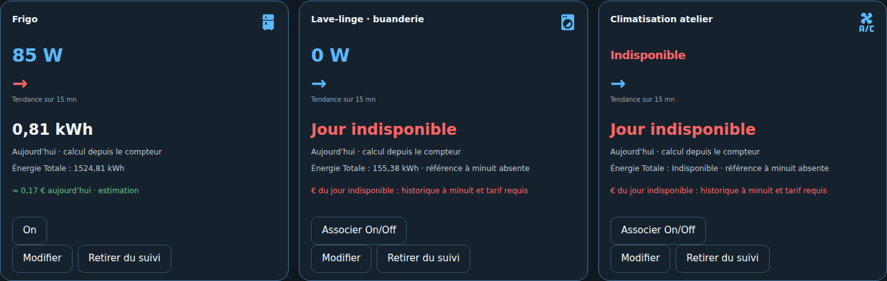

# Usages et Mes Appareils

Le panneau suit des entités déjà disponibles dans HA. **Mes Appareils** permet d'ajouter, modifier et retirer des appareils directement. **Usages** présente notamment routeur/cumulus et borne de recharge. Les identifiants sont conservés lors d'une modification ; retirer du suivi ne désinstalle pas l'intégration constructeur.

## Sources et icônes

Nom, puissance W/kW, énergie Wh/kWh, période du compteur, état facultatif et confirmation du périmètre maison. Le cumulus accepte aussi une température d'eau facultative. Au moins une source est nécessaire.

L'icône native MDI est choisie selon le nom : réfrigérateur, lave-linge, sèche-serviettes, piscine, climatisation, cafetière, etc. Le champ **Icône du produit** permet une sélection manuelle. Les sous-compteurs restent inclus dans Conso Maison ; ils ne sont jamais ajoutés ou soustraits à son bilan.

## Énergie quotidienne depuis un cumul

Déclarer la période réelle de la source : **aujourd'hui**, **session** ou **total cumulé**. Pour un cumul, le panneau utilise l'historique à minuit dans le fuseau HA et la variation jusqu'à maintenant, avec traitement des remises à zéro. **Énergie Totale** affiche le compteur source, distinct du résultat calculé du jour.

Exemple : 1 524,81 kWh actuellement − 1 524 kWh à minuit = **0,81 kWh aujourd'hui**. Sans référence historique exploitable à minuit, énergie et coût du jour restent indisponibles. Un compteur de session n'est pas transformé en compteur journalier. Un compteur déclaré « aujourd'hui » doit réellement couvrir le jour courant.

Le coût estimatif applique le tarif fixe configuré à l'énergie quotidienne exploitable, hors abonnement et revente. Ce n'est pas une facturation HP/HC ou Tempo.

## Cumulus et borne

La puissance réelle consommée est distincte de la consigne SSR, du pourcentage de routage ou d'un ordre de forçage. « Température non associée » signifie qu'aucun capteur de température n'est configuré ; « Température indisponible » concerne la source de température associée. Ces mentions ne signifient pas que la puissance du cumulus est indisponible. L'échelle thermique 0–100 °C n'est pas un stock énergétique mesuré.

La borne affiche sa puissance et l'énergie selon la période déclarée, avec une silhouette dédiée. Un état comme « branché » ne prouve pas une recharge active. Les régulations natives F1ATB et constructeur restent inchangées.

## Tendances

Libellé **Tendance sur 15 mn**. Une seule flèche par carte : hausse, baisse ou stabilité entre moyennes de quarts d'heure sur six heures. Sans données suffisantes, flèche horizontale et mention explicite. Rouge pour une charge consommant une puissance positive, bleue sinon ; production, export et décharge restent bleus. Le seuil de 10 W concerne seulement l'animation des flux, pas la couleur de consommation.

## Commandes manuelles On/Off

Une source d’état reste une lecture. Pour commander, associer séparément une entité switch, input_boolean, light ou fan et activer explicitement la commande manuelle. L’association seule ne commande rien. Le bouton remplace l’état textuel pour les appareils activés ; sans association, « Associer On/Off » ouvre les réglages.

Seul un administrateur peut envoyer l’action. Le serveur résout l’entité enregistrée, impose turn_on ou turn_off, vérifie la révision et l’état attendu, conserve le contexte utilisateur HA et refuse les commandes concurrentes ou les états inconnus/indisponibles. Une réponse positive signifie ordre transmis ; le bouton continue d’afficher l’état réellement publié par HA. Aucun scénario, rafraîchissement ou calcul d’objectif n’envoie d’ordre.

## Décalage de mesure à faible puissance

La tolérance négative est réglable de 0 à 20 W, 5 W par défaut. De −5 W inclus à 0 W, la mesure d’un appareil est corrigée en 0 W ; en dessous de la tolérance elle reste invalide. L’attribut source_raw_value conserve la lecture originale, negative_offset_corrected signale la correction. Aucune tolérance n’est appliquée au réseau signé, aux puissances de batterie ni au bilan Maison.

## Objectif énergétique du cumulus

Renseigner l’objectif quotidien en kWh dans Modifier l’usage, accessible aussi depuis la carte du cumulus dans Stockage. Avec 3 kWh d’objectif et 2,16 kWh du jour, l’avancement vaut **72 %**, sans décimale. La silhouette utilise cet avancement et la température reste distincte. Sans objectif, le visuel conserve son échelle de température. Sans énergie quotidienne exploitable, aucun pourcentage n’est inventé. Un compteur de session ne fournit pas cet indicateur journalier.

Cet objectif ne mesure pas la chaleur encore disponible : les soutirages et pertes thermiques ne sont pas déduits. Les batteries électriques continuent d’afficher leur SOC mesuré et leur stock réel ; leur capacité n’est pas un objectif journalier.
