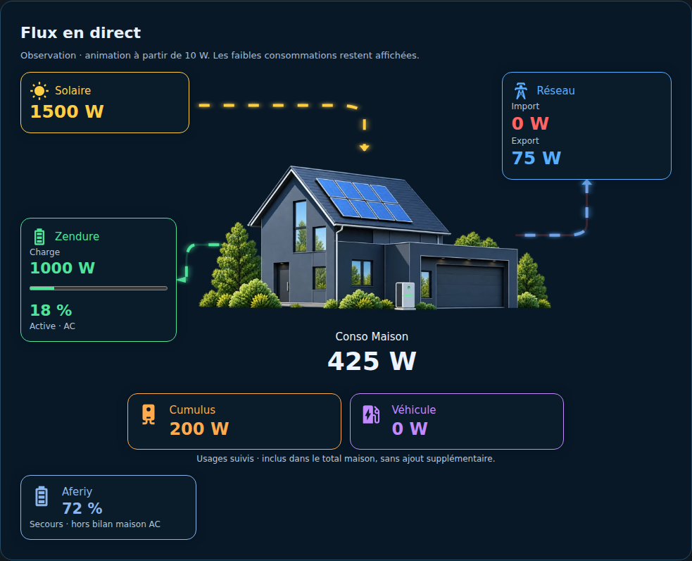

# 01 — Introduction et architecture

[Accueil](Home.md) · [Suite : préparation](02-Preparation.md)

eHome EMS rassemble les mesures déjà intégrées à Home Assistant : solaire, réseau, consommation réelle, batteries et sous-compteurs. Le backend Python normalise les sources et expose les diagnostics ; le panneau HA affiche les flux et historiques. Les assets sont locaux au paquet.

**Conso Maison = Solaire + Réseau signé − Charge batterie + Décharge batterie.** Le cumulus et la borne restent inclus. Une source maison existante peut être utilisée à la place du calcul EMS.

Le mode observation ne commande aucun équipement. Les scénarios répartissent un budget hypothétique saisi manuellement et ne sont pas exécutés. Prévisions énergétiques et pilotage coordonné restent dans la feuille de route.

[Modèle énergétique détaillé](../CONSOMMATION_MAISON.md) · [Feuille de route](../ROADMAP.md)
