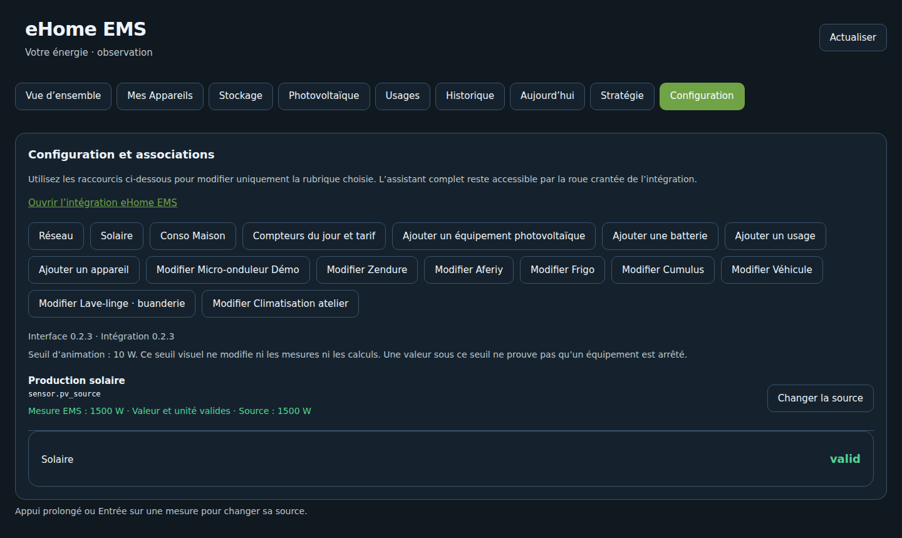

# 03 — Installer dans Home Assistant

[Accueil](Home.md) · [Précédent](02-Preparation.md) · [Suite : sources](06-Configuration-sources.md)

1. Ajouter le dépôt public `https://github.com/eHomeLabs/ehome-ems` aux dépôts personnalisés HACS / Marketplace, catégorie Intégration.
2. Installer **0.2.3**, puis redémarrer Home Assistant Core pour charger le code Python.
3. Ajouter eHome EMS depuis Paramètres → Appareils et services.
4. Suivre l'assistant, vérifier les mesures et confirmer en dernier.
5. Ouvrir le panneau eHome EMS dans la barre latérale.

Depuis la b15, conserver l'entrée existante et les associations : mettre à jour les fichiers, redémarrer HA Core puis recharger le navigateur. Les versions Interface et Intégration doivent toutes deux afficher 0.2.3.

Les modifications suivantes d'appareils, de sources et de tarifs utilisent les raccourcis du panneau et se rechargent automatiquement, sans redémarrage global.

[Procédure complète, installation manuelle et retour arrière](../INSTALLATION.md)
