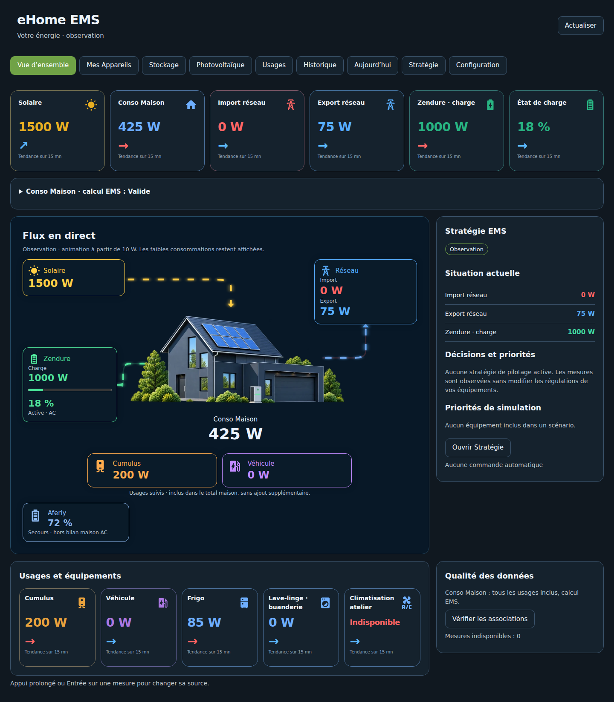
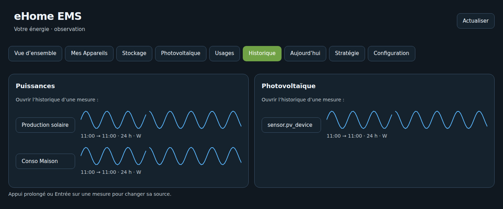
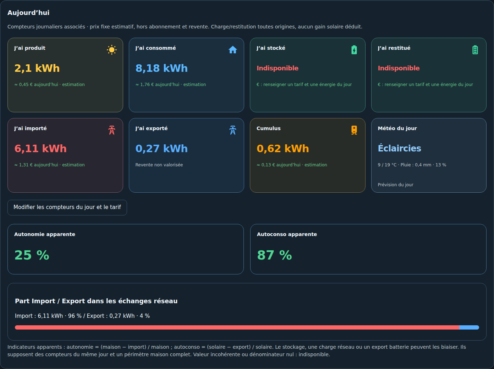

# 04 — Lire le dashboard

[Accueil](Home.md) · [Appareils et usages](05-Appareils-et-usages.md)

L'ordre est : Vue d'ensemble, Mes Appareils, Stockage, Photovoltaïque, Usages, Historique, Aujourd'hui, Stratégie, Configuration.

## Vue d'ensemble

Les cartes présentent la puissance et une seule flèche de tendance calculée par quarts d'heure sur six heures. Sans données suffisantes, la flèche est horizontale. Une charge consommant une puissance positive est rouge ; les autres cas, dont production et export, sont bleus. Les flux ne s'animent qu'à partir de 10 W, sans masquer les valeurs inférieures.

## Historique

Chaque ligne affiche sa source sur les 24 dernières heures. Les unités sont indiquées, les interruptions restent visibles et un clic sur le nom ouvre le détail natif HA. Les données viennent de History/Recorder, pas d'une courbe inventée.

## Aujourd'hui

Les compteurs associés fournissent production, consommation, charge, restitution et échanges réseau. Le tarif fixe donne une estimation hors abonnement et revente. Autonomie et autoconsommation sont des ratios apparents, sans preuve de l'origine solaire de l'énergie déchargée. La météo reprend une entité HA choisie.

[Description complète du panneau](../DASHBOARD_AUTOMATIQUE.md) · [Illustrations maison](../HOUSE_ASSETS.md)
