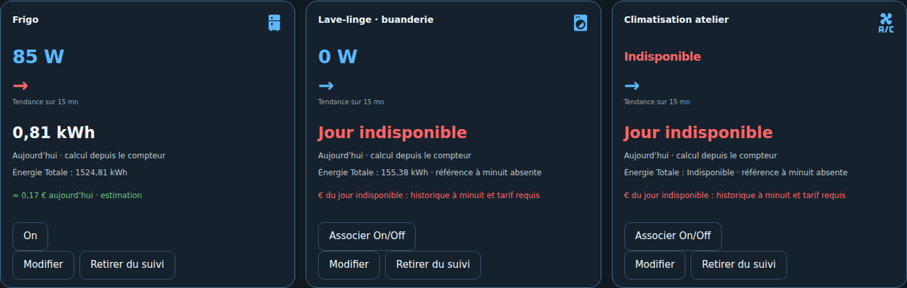
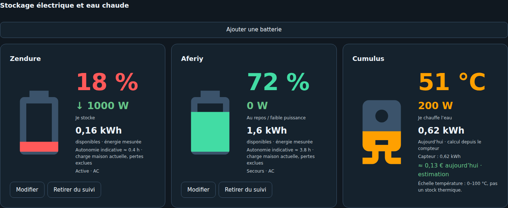

# 05 — Appareils, stockage et usages

[Accueil](Home.md) · [Sources](06-Configuration-sources.md)

## Mes Appareils

Ajouter directement depuis l'onglet, puis utiliser Modifier ou Retirer du suivi. L'icône est déduite du nom du produit, avec sélection manuelle MDI disponible. Les noms et identifiants sont conservés lors des modifications.

Énergie Totale désigne le compteur source. Un cumul permet de calculer l'énergie quotidienne à partir de la référence de minuit ; sans cette référence, le coût du jour reste indisponible. Une énergie de session garde sa période propre.

## Stockage

Le rôle actif AC participe au bilan maison. Le rôle secours et les mesures DC restent suivis séparément. Le SOC ne remplace pas un capteur de stock restant. Un capteur Wh/kWh classé comme cumul n'est accepté comme stock qu'après confirmation explicite de sa nature réelle ; le contrôle de capacité reste appliqué.

## Cumulus et borne

Les sous-comptages restent inclus dans Conso Maison. Le libellé « Température indisponible » du cumulus concerne uniquement la température de l'eau. La puissance est affichée séparément. L'illustration thermique ne mesure pas une énergie stockée.

[Sources et périodes détaillées](../USAGES_OBSERVATION.md)
