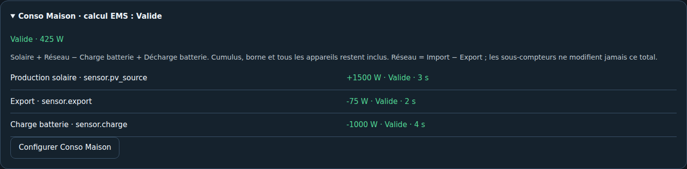

# 06 — Configurer les sources

[Accueil](Home.md) · [Précédent : installation](03-Installation-Home-Assistant.md) · [Suite : validation](07-Validation.md)

Commencer par l'assistant de l'intégration. Après sa confirmation, utiliser **Configuration** pour modifier un groupe, et **Mes Appareils** pour ajouter ou modifier un équipement. La roue de l'intégration permet de reprendre volontairement le parcours complet.

## Conso Maison

Choisir une mesure existante couvrant tous les usages, ou le calcul automatique EMS. Pour ce dernier : confirmer le périmètre AC, déclarer solaire et stockage réellement présents, puis choisir le réseau signé ou la paire Import/Export. En Auto, la paire complète est prioritaire. Ne pas ajouter les sous-compteurs au total.

Les sources absentes, invalides ou incohérentes bloquent le résultat. La fraîcheur peut avertir sans bloquer ou être stricte. Un 0 W stable n'est pas nécessairement une source en panne ; adapter la politique aux publications du capteur.

## Énergie et météo

Choisir la période réelle de chaque compteur : quotidien, cumul ou session. Les compteurs de l'onglet Aujourd'hui doivent être journaliers. Associer le tarif fixe facultatif et une entité météo HA si souhaité.

[Conso Maison](../CONSOMMATION_MAISON.md) · [Assistant et validation](../VALIDATION_ASSISTANT.md)
