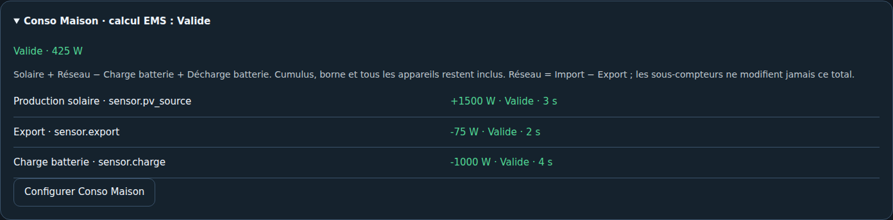

# 07 — Vérifier les mesures

[Accueil](Home.md) · [Suite : sauvegarde et mises à jour](08-Sauvegarde-et-restauration.md)

Dans le résumé de l'assistant, **valid apparaît en vert**, les autres qualités en rouge. Ce contrôle valide la lecture et l'unité, pas le placement physique des pinces. Les raccourcis de correction précèdent « Continuer vers la confirmation », placé en dernier.

- Comparer chaque puissance à sa source HA ; vérifier le signe du réseau.
- Vérifier que charge et décharge batterie sont des puissances AC distinctes.
- Examiner les contributions au bilan Maison ; cumulus et borne restent inclus.
- Contrôler la période des énergies et la référence historique de minuit pour un cumul.
- Vérifier que changer un réglage conserve les autres associations et recharge l'entrée.
- Confirmer qu'aucun équipement n'est commandé par observation ou simulation.

[Contrôles automatisés et limites de validation](../VALIDATION_ASSISTANT.md) · [Revue 0.2.1](../REVUE_0_2_1.md)
