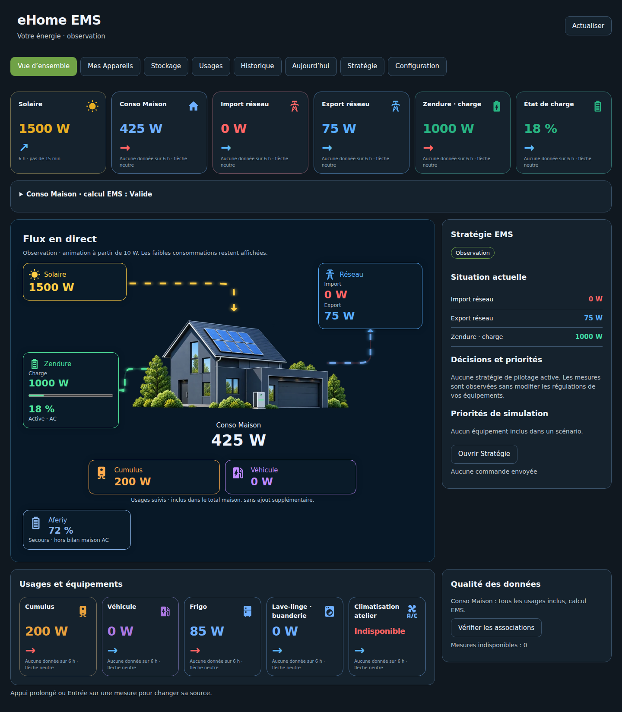

# eHome EMS — Wiki 0.2.1

**Votre installation. Vos équipements. Votre énergie. Un EMS sur mesure.**

Ce wiki décrit l'intégration Home Assistant disponible en **0.2.1**, issue du socle b15 validé en usage. Elle fonctionne en observation et propose des scénarios manuels, sans commande physique. Aucun serveur ou ordinateur supplémentaire n'est requis.

## Parcours conseillé

| Étape | Guide |
| --- | --- |
| Comprendre le produit | [Introduction et architecture](01-Introduction.md) |
| Préparer les sources | [Prérequis et mesures](02-Preparation.md) |
| Installer ou migrer depuis la b15 | [Installation Home Assistant](03-Installation-Home-Assistant.md) |
| Faire la première association | [Configurer les sources](06-Configuration-sources.md) |
| Lire les flux et indicateurs | [Découvrir le dashboard](04-Dashboard.md) |
| Ajouter ou modifier un appareil | [Appareils, stockage et usages](05-Appareils-et-usages.md) |
| Vérifier la cohérence | [Validation](07-Validation.md) |
| Comprendre les redémarrages | [Sauvegarde et mises à jour](08-Sauvegarde-et-restauration.md) |
| Résoudre un problème | [Dépannage](09-Depannage.md) |
| Conserver un relevé privé | [Journal local](10-Journal-installation.md) |

## La maison de jour et de nuit

Jour de 07:00 à 18:59, nuit de 19:00 à 06:59 dans le fuseau HA. Voir [Illustrations maison](../HOUSE_ASSETS.md).

[README](../../README.md) · [Notes 0.2.1](../RELEASE_0_2_1.md) · [Feuille de route](../ROADMAP.md)
